# PRD — Open Source Serverless Approval System (Overlimit Reimbursement)
> **Version:** 1.0.0 | **Status:** 🟡 Draft | **Last Updated:** 2026-10-17  
> **Author:** indarto.b@gmail.com (requester) | **Reviewer:** [TBD] | **Stakeholder:** [TBD]

---

## Table of Contents
1. [Overview](#1-overview)
2. [Goals & Success Metrics](#2-goals--success-metrics)
3. [Requirements](#3-requirements)
4. [Core Features](#4-core-features)
5. [User Roles & Permissions](#5-user-roles--permissions)
6. [User Flow](#6-user-flow)
7. [Screen & UI Breakdown](#7-screen--ui-breakdown)
8. [Architecture](#8-architecture)
9. [Database Schema](#9-database-schema)
10. [API Endpoints](#10-api-endpoints)
11. [Design & Technical Constraints](#11-design--technical-constraints)
12. [Out of Scope](#12-out-of-scope)
13. [Risks & Mitigations](#13-risks--mitigations)
14. [Timeline & Milestones](#14-timeline--milestones)
15. [Open Questions](#15-open-questions)

> **Basis of this document:** reverse-engineered from the repository `Yuin-Labs/open-source-approval-system` (commit `6c7ba59`, 2026-10-10: `src/code.gs`, `report.gs`, `button.gs`, `FormReason.html`, `FormFinance.html`, `templates/*.csv`, `README.md`). Features marked ✅ Done exist in the code; 🔲 items are hardening work proposed in this PRD. Every assumption is logged in [Section 15](#15-open-questions).

---

## 1. Overview

### Problem Statement
> *Describe the core problem being solved. Who is affected, and what happens if it remains unsolved?*

Employees submit reimbursement requests that exceed their monthly spending limit ("overlimit"). Without a system, these requests travel through chat and email, with no fixed approval chain (HR → Direct Manager → Head of Business → Finance), no proof of who approved what and when, and no automatic escalation when the amount exceeds the limit. HR and Finance re-key data by hand, approvers decide without seeing the requester's month-to-date history, and Finance cannot predict when a payment is due. If left unsolved, organisations carry audit-trail gaps, duplicate or unauthorised payouts, and long, unpredictable reimbursement cycles. Small and mid-size companies also often cannot justify a dedicated workflow platform or server.

### Solution Summary
> *A 2–3 sentence summary of the proposed solution.*

A serverless approval engine built entirely on Google Workspace (Google Forms, Sheets, Apps Script, Gmail, Drive). A Form submission is enriched with employee master data, routed through configurable HR → L1 → L2 approval tiers (with automatic L2 bypass or escalation based on overlimit detection), and decided via one-click email links that open an authenticated Web App. After full approval, Finance receives a disbursement portal to upload the transfer receipt, a due date is computed from a fixed SLA calendar, and completed records are archived to a reporting spreadsheet.

### Target Users
| Persona | Description | Primary Need |
|---------|-------------|--------------|
| Requester (Employee / ex-employee) | Staff who submit an overlimit reimbursement via Google Form | Submit once, know the status, get paid on a predictable date |
| HR Verifier | HR admin who does the first verification of receipts and amount | See complete context in one email, correct the amount, hold or reject with a reason |
| L1 Approver (Direct Manager) | Manager of the requester | Approve or reject team requests quickly from email |
| L2 Approver (Head of Business) | Senior manager, only involved for overlimit requests or specific companies | See the requester's month-to-date history before deciding |
| Finance Officer | Disburses the reimbursement | Receive only fully approved requests with bank details, approval log and a due date |
| Super Admin | Designated override approver (e.g. when an approver is unavailable) | Decide on behalf of any level, with mandatory evidence and an audit label |
| System Owner (Spreadsheet admin) | Person who owns the Sheet, Script, Config and triggers | Configure routing and mappings without code changes; run manual sync, resend and archive |

---

## 2. Goals & Success Metrics

### Business Goals
- [ ] Route 100% of overlimit reimbursement requests through the defined approval chain with no manual forwarding
- [ ] Keep a complete, tamper-evident decision trail (approver, timestamp, reason) for every request
- [ ] Reduce HR and Finance manual data entry by pre-filling employee, manager and bank data from master data
- [ ] Give Finance a predictable disbursement due date for every approved request
- [ ] Run with zero infrastructure cost and no server to maintain

### Key Performance Indicators (KPIs)
| Metric | Current Baseline | Target | How to Measure |
|--------|-----------------|--------|----------------|
| Median approval cycle time (form submit → final approval) | None (new process); capture first 4 weeks after go-live | ≤ 2 working days | `Timestamp` to last `Approval … at` in Working Sheet |
| Requests with complete decision log (status + by + at + reason at every active level) | None (new process) | 100% | Archive audit query on `Raw Data` |
| Requests needing manual intervention (manual sync, resend, super admin override) | None (new process) | < 5% of requests | Count of `SUPPORT SUPER ADMIN` statuses + menu-triggered runs |
| Finance disbursement completed by due date | None (new process) | ≥ 95% | `Due Date Finance` vs. transfer date in Finance records |
| Requests stuck in HOLD beyond reminder date | None (new process) | 0 | Daily count of `Status = HOLD` with reminder date in the past |

---

## 3. Requirements

### Functional Requirements
| ID | Category | Requirement | Priority |
|----|----------|-------------|----------|
| FR-01 | Intake | Each Google Form response is copied to the Working Sheet exactly once, using the column mapping in `Config Working Sheet` | 🔴 Must Have |
| FR-02 | Intake | Employee data (position, department, L1/L2 manager and emails, employment status) is looked up from `empdb` by email; unmatched fields are filled with `Not Found` | 🔴 Must Have |
| FR-03 | Routing | The system routes each request HR → L1 → L2 and only advances when the previous level is approved | 🔴 Must Have |
| FR-04 | Routing | L2 is bypassed automatically when (a) the company follows the normal flow and the request is not overlimit, or (b) no L2 manager exists; all other cases go to L2 | 🔴 Must Have |
| FR-05 | Routing | Overlimit is detected when `Current Usage` > `Limit` (values parsed from numeric text) | 🔴 Must Have |
| FR-06 | Notification | Approval email contains request details, attachments, and Approve / Reject (and Hold for HR) links | 🔴 Must Have |
| FR-07 | Authorization | A decision is accepted only from the intended approver's Google account or a Super Admin | 🔴 Must Have |
| FR-08 | Decision | Every decision records status, timestamp, approver and a mandatory reason | 🔴 Must Have |
| FR-09 | Decision | A recorded decision cannot be changed through the Web App | 🔴 Must Have |
| FR-10 | Decision | HR may edit the requested amount while approving | 🟠 Should Have |
| FR-11 | Finance | After full approval, Finance receives a link to a disbursement form that shows bank details, amount and approval log and accepts a transfer receipt upload | 🔴 Must Have |
| FR-12 | Finance | The system computes a Finance due date from the submit time using the Tue/Thu SLA calendar and stores it | 🔴 Must Have |
| FR-13 | Finance | A request can be submitted to Finance only once (`Sent to Finance = DONE`) | 🔴 Must Have |
| FR-14 | Notification | Requester is emailed on final approval and on rejection (with the rejecting level's reason) | 🟠 Should Have |
| FR-15 | Hold | HR can put a request on HOLD with a reminder date; a scheduled check re-opens the HR step when the date arrives | 🟠 Should Have |
| FR-16 | Override | Super Admin can approve or reject any level; evidence upload is requested and the status is labelled `SUPPORT SUPER ADMIN` | 🟠 Should Have |
| FR-17 | Reporting | Completed (`DONE`) rows are copied once to a separate archive spreadsheet using `Config to Report` mapping | 🟠 Should Have |
| FR-18 | Operations | A spreadsheet menu offers manual sync, hold check, resend rejection email and archive | 🟠 Should Have |
| FR-19 | Concurrency | Row creation, routing and decisions run under a script lock to prevent double processing | 🔴 Must Have |
| FR-20 | Hardening | Requests are identified by a stable Request ID instead of the sheet row number | 🟠 Should Have |
| FR-21 | Hardening | An append-only audit log sheet records every state change and email sent | 🟠 Should Have |
| FR-22 | Hardening | Time-driven triggers for hold reminders and archiving are documented and provisioned by a setup function | 🟡 Nice to Have |

**Priority Legend:**
- 🔴 **Must Have** — Required for MVP; the system cannot function without it
- 🟠 **Should Have** — Important but can be deferred to the next iteration
- 🟡 **Nice to Have** — Improves experience but is not a priority

### Non-Functional Requirements
| Category | Requirement | Target |
|----------|-------------|--------|
| **Performance** | Decision page load and submit response | < 5 seconds (Apps Script cold start included) |
| **Performance** | Single Apps Script execution | < 6 minutes (platform limit); lock wait ≤ 15–20 s |
| **Accessibility** | Supported platforms | Any modern browser and email client (desktop and mobile) |
| **Security** | Authentication method | Google account session (Web App deployed "Anyone with Google account") + approver email match |
| **Security** | Data residency / access | Data stays in the owner's Google Workspace; Sheet shared only with System Owner(s) |
| **Scalability** | Number of users / volume | Up to ~500 employees and ~1,000 requests/month; ≤ 10,000 Working Sheet rows before archiving |
| **Availability** | Uptime | Follows Google Workspace SLA (≥ 99.9%); no self-hosted component |
| **Auditability** | Decision trail | 100% of decisions with by / at / reason; archive retained per company policy (see Q-09) |
| **Quota** | Outbound email | Within Gmail/Apps Script daily quota (see R-05) |

---

## 4. Core Features

### Feature List

| ID | Feature | Brief Description | Priority | Status |
|----|---------|-------------------|----------|--------|
| F-01 | Request Intake & Data Enrichment | Form response → Working Sheet with config-driven mapping and `empdb` lookup | 🔴 Must Have | ✅ Done |
| F-02 | Multi-Tier Approval Routing | HR → L1 → L2 state machine with overlimit-based L2 bypass/escalation | 🔴 Must Have | ✅ Done |
| F-03 | Actionable Approval Email | Email with details, history table, attachments and one-click links | 🔴 Must Have | ✅ Done |
| F-04 | Authenticated Decision Web App | Reason form, approver authorization, immutable decision | 🔴 Must Have | ✅ Done |
| F-05 | Finance Disbursement Portal | Receipt upload, SLA due date, email to Finance | 🔴 Must Have | ✅ Done |
| F-06 | Requester Notifications | Final-approval and rejection emails; resend rejection | 🟠 Should Have | ✅ Done |
| F-07 | Hold & Reminder | HR hold with reminder date and scheduled re-open | 🟠 Should Have | ✅ Done |
| F-08 | Super Admin Override | Decide on behalf of any level with evidence | 🟠 Should Have | ✅ Done |
| F-09 | Reporting Archive | Move `DONE` rows to archive spreadsheet | 🟠 Should Have | ✅ Done |
| F-10 | Admin Menu & Manual Sync | Spreadsheet menu for recovery operations | 🟠 Should Have | ✅ Done |
| F-11 | Hardening: Request ID, Audit Log, Trigger Setup | Stable IDs, append-only log, provisioned triggers, config validation | 🟠 Should Have | 🔲 Not Started |

**Status Legend:** 🔲 Not Started | 🔵 In Progress | ✅ Done | ❌ Cancelled

---

### F-01: Request Intake & Data Enrichment
> Converts a raw Google Form response into a normalised Working Sheet row, enriched from the employee master, so that approvers and Finance never re-key data.

**User Story:**
> As a `Requester`, I want to `submit one form with my amount, reason and attachments`, so that I can `start the approval without contacting HR manually`.

**Acceptance Criteria:**
- [ ] On form submit (installable trigger `onFormSubmit`), a new Working Sheet row is appended and the Form Responses row is marked `status to working sheet = DONE`
- [ ] Each Working Sheet column listed in `Config Working Sheet` is filled from `Form Responses 1`, from `empdb`, or from a formula that supports `{row}` and `{email_col}` placeholders
- [ ] Employee lookup is case-insensitive and trimmed on email
- [ ] Re-processing a row already marked `DONE` creates no duplicate
- [ ] `Sync Manual (Pending Rows)` processes every unmarked response and every non-final Working Sheet row

**Edge Cases & Error Handling:**
- If the requester's email is not in `empdb` → System must fill employee-derived columns with `Not Found` and still create the row
- If the script lock cannot be acquired within 15 s → System must skip silently and leave the response unmarked so manual sync picks it up
- If a target header in `Config Working Sheet` does not exist in the Working Sheet → System must skip that mapping row without failing the run
- If the same response is processed twice (trigger retry) → System must detect `DONE` and return without writing
- If an unexpected exception occurs → System must log to console and leave the response unmarked (see F-11 for audit log)

---

### F-02: Multi-Tier Approval Routing
> A state machine over the HR, L1 and L2 status columns. It runs after intake and after every decision, up to 5 iterations per call.

**User Story:**
> As an `HR Verifier`, I want `requests to reach the right approvers in order and be escalated when over the limit`, so that I can `enforce policy without chasing people`.

**Acceptance Criteria:**
- [ ] Empty HR status → set `SENT TO HR` and email HR
- [ ] HR `APPROVE` (or Super Admin support) and L1 empty → email L1
- [ ] After L1 approval: if company follows normal flow and `Current Usage ≤ Limit` → L2 set to `BYPASSED (Normal Flow)`; if L2 manager is empty or `-` → `BYPASSED (No L2 Data)`; otherwise email L2
- [ ] All three levels approved/bypassed → `Status = DONE`, requester and Finance notified exactly once
- [ ] Any level `REJECT` → `Status = REJECTED`, requester emailed with the rejecting level's reason
- [ ] `Status` in `DONE`, `REJECTED`, `HOLD` stops routing

**Edge Cases & Error Handling:**
- If `Current Usage` or `Limit` is empty or non-numeric → System must treat the value as 0 (see Q-05)
- If a level's manager email is empty → System must not send and must leave the row waiting (visible to admin via manual sync; see R-03)
- If a decision arrives for a level whose predecessor is not approved → System must refuse with a "waiting for previous level" page
- If routing is triggered concurrently by form submit and a decision → System must serialise through the script lock (20 s wait)

---

### F-03: Actionable Approval Email
> HTML email per level with a detail table, attachments and secure action links.

**User Story:**
> As an `L1 Approver`, I want to `see the request and approve or reject from my email`, so that I can `decide in under a minute`.

**Acceptance Criteria:**
- [ ] Email shows timestamp (GMT+7), name, employee ID, position, requested amount, limit, month-to-date usage, reason, detail and attachment links
- [ ] Supporting Drive files are attached to the email when readable
- [ ] Approve and Reject links for all levels; Hold link for HR only
- [ ] Links route through Google AccountChooser so the approver is signed in before the Web App opens
- [ ] L2 overlimit email includes a table of the requester's non-rejected requests in the same month with the current row highlighted and a total; L1 and HR are CC'd per config

**Edge Cases & Error Handling:**
- If a recipient email cannot be resolved → System must not call MailApp and must return without error
- If a Drive attachment cannot be read → System must still send the email with the link only
- If the email quota is exhausted → System must surface the failure (see F-11 audit log; R-05)
- If the company has an alias config → System must send from the alias with the configured sender name

---

### F-04: Authenticated Decision Web App
> `doGet` validates the request, `FormReason.html` collects the reason, `executeApprovalFromWeb` persists the decision.

**User Story:**
> As an `L2 Approver`, I want to `confirm my decision with a reason`, so that I can `leave an auditable justification`.

**Acceptance Criteria:**
- [ ] `row`, `level`, `action` are all required; otherwise an error page is shown
- [ ] The signed-in Google email must match the intended approver for the level (HR from config, L1/L2 from the row) unless it is in `EMAIL_SUPER_ADMIN`
- [ ] A reason is mandatory; Hold additionally requires a reminder date-time
- [ ] If the level already has `APPROVE`, `REJECT` or `BYPASSED`, the page states the decision cannot be changed
- [ ] HR approving may change the amount; the new amount replaces `Total Pengajuan`
- [ ] Successful approve triggers routing to the next level immediately

**Edge Cases & Error Handling:**
- If the Google session email is empty → System must show "Google session not detected" and record nothing
- If the signed-in user is not the intended approver and not Super Admin → System must show "Access denied"
- If the row no longer has an employee name → System must show "Data not found / deleted"
- If another execution holds the lock for more than 15 s → System must show "System busy, try again"
- If the same link is opened twice → System must show "decision already saved"

---

### F-05: Finance Disbursement Portal
> Opened from the full-approval email sent to `EMAIL_HR`; Finance uploads the transfer receipt and the system notifies Finance with an SLA due date.

**User Story:**
> As a `Finance Officer`, I want to `see bank details, amount and the approval log, then upload the transfer receipt`, so that I can `close the request with proof`.

**Acceptance Criteria:**
- [ ] The portal shows company, name, bank name, account number, account holder, region, division code, amount and the HR/L1/L2 approval log
- [ ] Upload accepts image or PDF and stores it in the configured Drive folder; the URL is written to `Lampiran ke Finance`
- [ ] Email to `EMAIL_FINANCE` includes amount, due date, approval log, the receipt and the original attachments
- [ ] Due date follows the SLA table in Section 10 and is written to `Due Date Finance`
- [ ] `Sent to Finance` is set to `DONE` after the email is sent and blocks any second submission

**Edge Cases & Error Handling:**
- If `Sent to Finance = DONE` → System must show "already sent to Finance" (on open and on submit)
- If no file is selected or the file is unreadable → System must show a failure message and write nothing
- If `EMAIL_FINANCE` is not configured → System must show a configuration error and not mark `DONE`
- If the Drive folder ID is invalid → System must return the error text and not mark `DONE`
- If the row was deleted → System must show "data missing"

---

### F-06: Requester Notifications
> Final-approval email (status: now with Finance) and rejection email (rejecting level, reason, original details).

**User Story:**
> As a `Requester`, I want to `be told the outcome with the reason`, so that I can `correct and resubmit if needed`.

**Acceptance Criteria:**
- [ ] Final-approval email lists HR, L1 and L2 (marking bypassed levels)
- [ ] Rejection email contains the reason stored for the rejecting level, amount, date, reason and attachment links
- [ ] Ex-employees (employment status contains `ex-karyawan`) are emailed at the personal `Requester Email`
- [ ] Menu `Resent Email Rejection` re-sends for a chosen row number

**Edge Cases & Error Handling:**
- If requester email is empty → System must skip without error
- If the rejection reason is empty → System must send "no specific reason"
- If an invalid row number is entered in the resend prompt → System must alert and send nothing

---

### F-07: Hold & Reminder
> HR can defer a request; a scheduled run re-opens HR.

**User Story:**
> As an `HR Verifier`, I want to `park a request until a given date`, so that I can `wait for missing documents without losing it`.

**Acceptance Criteria:**
- [ ] Hold sets `Status = HOLD`, stores the reminder date-time and stops routing
- [ ] `cekReminderHold` (menu or trigger) re-emails HR, sets HR status back to `SENT TO HR` and clears `Status` and the date once the reminder date is reached

**Edge Cases & Error Handling:**
- If the reminder date is missing on a Hold → System must reject the submit in the form
- If the stored reminder date is not a valid date → System must skip the row
- If the reminder column configured differs from the column written by the decision → hold will never be re-opened (known defect, see Q-06)

---

### F-08: Super Admin Override
> A named list of Super Admins can decide at any level.

**User Story:**
> As a `Super Admin`, I want to `decide on behalf of an unavailable approver with evidence`, so that I can `unblock a request without breaking the audit trail`.

**Acceptance Criteria:**
- [ ] Super Admin sees an evidence upload field (PDF/JPG/PNG); the file is stored in a Drive folder and linked as `Support by Super Admin`
- [ ] Status text becomes `APPROVE - SUPPORT SUPER ADMIN` or `REJECTED - SUPPORT SUPER ADMIN`
- [ ] Routing treats the support statuses as approved

**Edge Cases & Error Handling:**
- If evidence upload fails → System must still record the decision and mark it `Support by Super Admin (Tanpa Lampiran)` (known weakness; see Q-07)
- If the Super Admin folder ID is a placeholder → upload silently fails; configuration check required (F-11)

---

### F-09: Reporting Archive
> Moves finished requests to a reporting spreadsheet using a header mapping.

**User Story:**
> As a `System Owner`, I want to `archive completed rows into a separate report sheet`, so that I can `keep the Working Sheet fast and the report stable`.

**Acceptance Criteria:**
- [ ] Only rows with `Status = DONE` and `Move to report ≠ DONE` are copied
- [ ] Column order and source are defined by `Config to Report` (`Target Header` ← `Source Header`)
- [ ] Copied rows are flagged `Move to report = DONE`

**Edge Cases & Error Handling:**
- If any required sheet or header is missing → System must stop and log the specific error without partial writes
- If no rows qualify → System must exit without writing
- If target sheet is empty → System must write the header row first

---

### F-10: Admin Menu & Manual Sync
> Custom menu `SISTEM APPROVAL` on spreadsheet open.

**User Story:**
> As a `System Owner`, I want to `trigger recovery actions from the sheet`, so that I can `fix stuck requests without opening the script editor`.

**Acceptance Criteria:**
- [ ] Menu items: Sync Manual (Pending Rows), Cek Hold Status, Resent Email Rejection, Pindah Data Report
- [ ] Manual sync stops at the first empty timestamp / first column cell

**Edge Cases & Error Handling:**
- If the user lacks script authorisation → Google shows the standard authorisation prompt; System must not partially run
- If a response row cannot be moved → System must continue with the next row

---

### F-11: Hardening — Request ID, Audit Log, Trigger Setup
> Closes the structural gaps found in the code review (see Section 13).

**User Story:**
> As a `System Owner`, I want to `address requests by a stable ID and keep an append-only log`, so that I can `pass an audit and survive row deletions`.

**Acceptance Criteria:**
- [ ] Each Working Sheet row gets a UUID `Request ID` at creation; links use the ID (rows may be re-sorted or deleted safely)
- [ ] An `Audit Log` sheet records timestamp, request ID, actor email, action, level, old/new status and email sent/failed
- [ ] `setupTriggers()` creates the form-submit, hold-reminder and archive triggers idempotently
- [ ] `validateConfig()` verifies every required `Config` key, folder ID and header and reports missing items

**Edge Cases & Error Handling:**
- If a link carries an unknown Request ID → System must show "Data not found"
- If a trigger already exists → `setupTriggers()` must not create a duplicate
- If a required config key is missing → `validateConfig()` must list it and block go-live

---

## 5. User Roles & Permissions

```
┌─────────────────────────────────────────────────────────────┐
│                    ROLE HIERARCHY                            │
│                                                             │
│  🛠️ System Owner                                            │
│     └── Owns Sheet/Script/Config; runs menu operations      │
│                                                             │
│  👑 Super Admin                                             │
│     └── Override decision at any level (with evidence)      │
│                                                             │
│  💰 Finance Officer                                         │
│     └── Disbursement form after full approval               │
│                                                             │
│  ✅ Approvers: HR Verifier → L1 Manager → L2 Head           │
│     └── Decide only at their own level, in order            │
│                                                             │
│  👤 Requester                                               │
│     └── Submit form, receive outcome emails                 │
└─────────────────────────────────────────────────────────────┘
```

| Feature / Action | Requester | HR Verifier | L1 Manager | L2 Head | Finance | Super Admin | System Owner |
|---|:---:|:---:|:---:|:---:|:---:|:---:|:---:|
| Submit overlimit request (Form) | ✅ | ✅ | ✅ | ✅ | ✅ | ✅ | ✅ |
| Receive outcome email | ✅ | ❌ | ❌ | ❌ | ❌ | ❌ | ❌ |
| HR decision (approve / reject / hold) | ❌ | ✅ | ❌ | ❌ | ❌ | ✅ | ❌ |
| Edit amount while approving | ❌ | ✅ | ❌ | ❌ | ❌ | ✅ | ❌ |
| L1 decision (approve / reject) | ❌ | ❌ | ✅ | ❌ | ❌ | ✅ | ❌ |
| L2 decision (approve / reject) | ❌ | ❌ | ❌ | ✅ | ❌ | ✅ | ❌ |
| Change a saved decision | ❌ | ❌ | ❌ | ❌ | ❌ | ❌ | ❌ |
| Open Finance disbursement form | ❌ | ❌ | ❌ | ❌ | ✅ | ❌ | ❌ |
| Upload transfer receipt | ❌ | ❌ | ❌ | ❌ | ✅ | ❌ | ❌ |
| Edit Config / empdb / mappings | ❌ | ❌ | ❌ | ❌ | ❌ | ❌ | ✅ |
| Run manual sync / hold check / resend / archive | ❌ | ❌ | ❌ | ❌ | ❌ | ❌ | ✅ |
| View Working Sheet | ❌ | ✅ (view) | ❌ | ❌ | ❌ | ✅ | ✅ |

> *Assumption: HR, Finance and approvers do not have edit access to the Working Sheet (Q-08). Note that a user with sheet edit access could bypass every control in this matrix.*

---

## 6. User Flow

### 6.1 High-Level User Journey

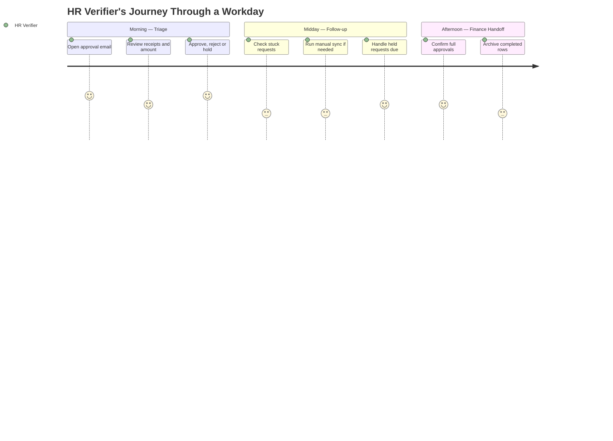

---

### 6.2 Authentication Flow

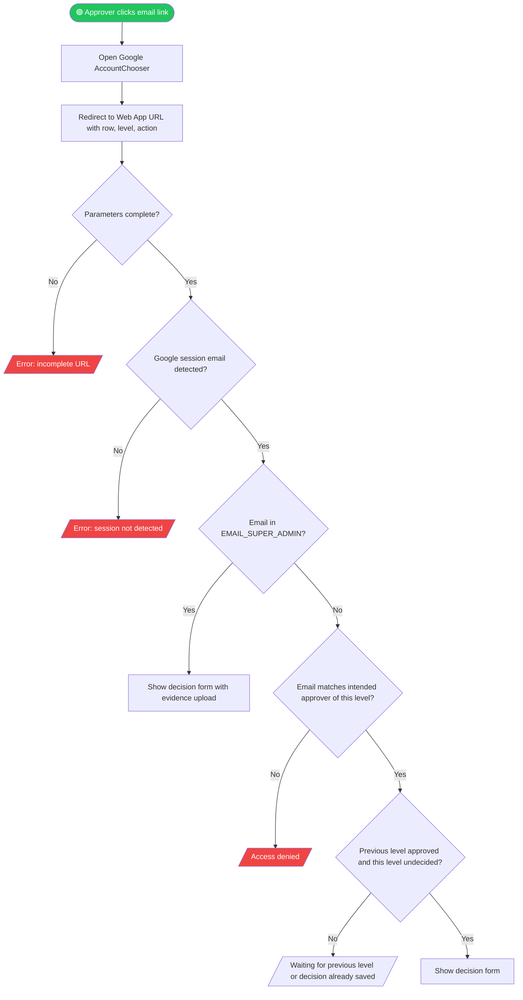

---

### 6.3 Main Application Flow

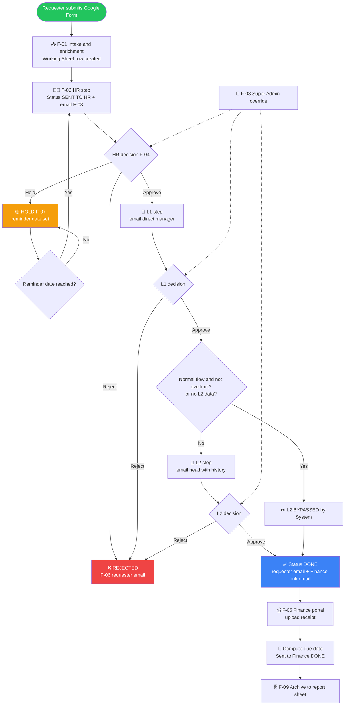

---

### 6.4 Critical Sub-Flow: Intake and Routing

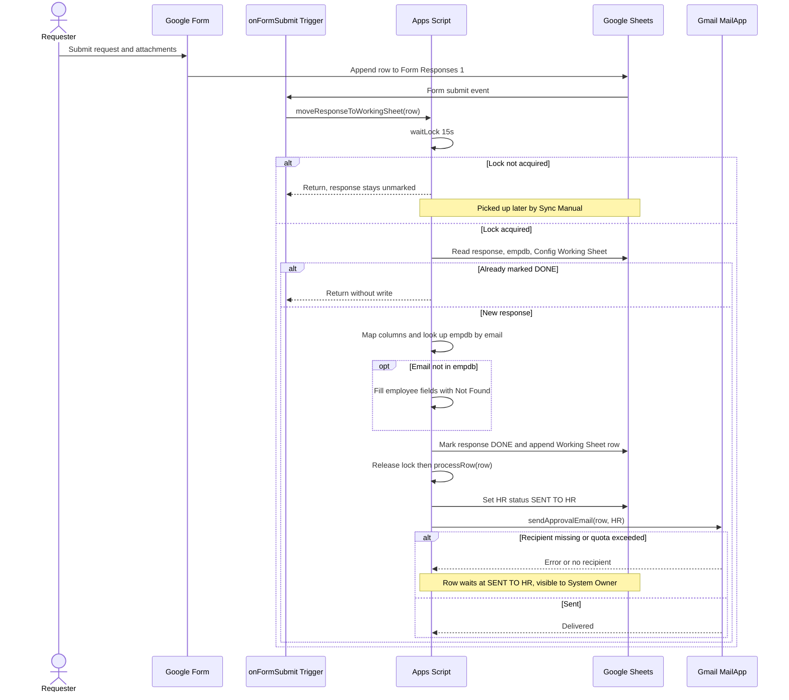

---

### 6.5 Critical Sub-Flow: Approval Decision

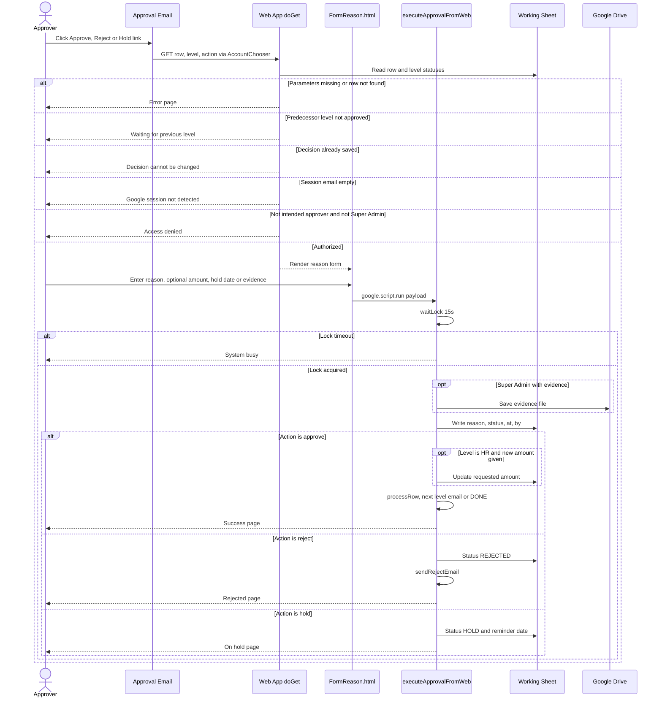

---

### 6.6 Critical Sub-Flow: Finance Disbursement

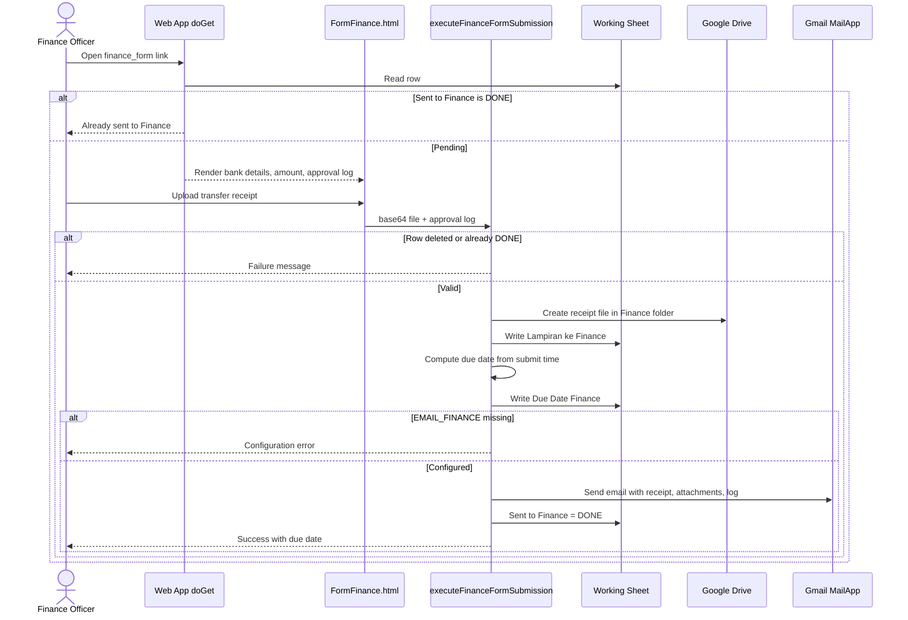

---

### 6.7 Critical Sub-Flow: Hold Reminder and Archive

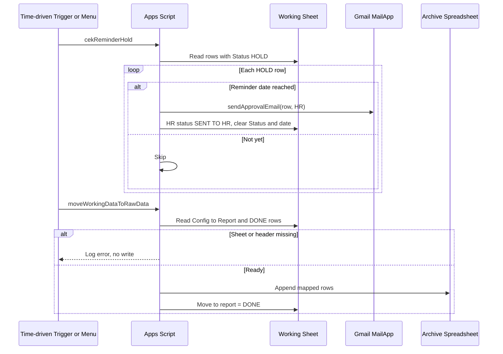

---

## 7. Screen & UI Breakdown

### Screen List

| ID | Screen Name | Route / Path | Brief Description |
|----|-------------|--------------|-------------------|
| S-01 | Overlimit Request Form | Google Form (linked to the Sheet) | Requester input: amount, reason, detail, attachments, transaction date |
| S-02 | Approval Email | Gmail (HTML) | Details, attachments, Approve / Reject / Hold buttons per level |
| S-03 | Decision Form | `{WEB_APP_URL}?row=&level=&action=approve\|reject\|hold` | Reason (mandatory), HR amount edit, hold date, Super Admin evidence |
| S-04 | Finance Disbursement Form | `{WEB_APP_URL}?row=&level=FINANCE&action=finance_form` | Bank details, amount, approval log, receipt upload |
| S-05 | Status / Error Page | Same Web App routes | Result of a decision or a blocked action |
| S-06 | Working Sheet & Admin Menu | Google Sheet, menu `SISTEM APPROVAL` | Operational view and recovery actions |
| S-07 | Outcome Emails | Gmail (HTML) | Final approval, rejection and Finance notification |

### Wireframe / Layout Notes

**S-03: Decision Form**
```
┌────────────────────────────────────────────────────┐
│  APPROVE / REJECT / HOLD        (colour by action) │
├────────────────────────────────────────────────────┤
│  Request row #[N]   Level: [HR|L1|L2]              │
│                                                    │
│  ✏️ Edit Total Pengajuan   [ 911000        ]  (HR) │
│  📅 Reminder Hold          [ date-time      ] (Hold)│
│  📎 Super Admin evidence   [ choose file    ] (SA) │
│                                                    │
│  Justification (required)                          │
│  ┌──────────────────────────────────────────────┐  │
│  │                                              │  │
│  └──────────────────────────────────────────────┘  │
│                         [ Submit ]                 │
└────────────────────────────────────────────────────┘
```

---

## 8. Architecture

### System Architecture Overview

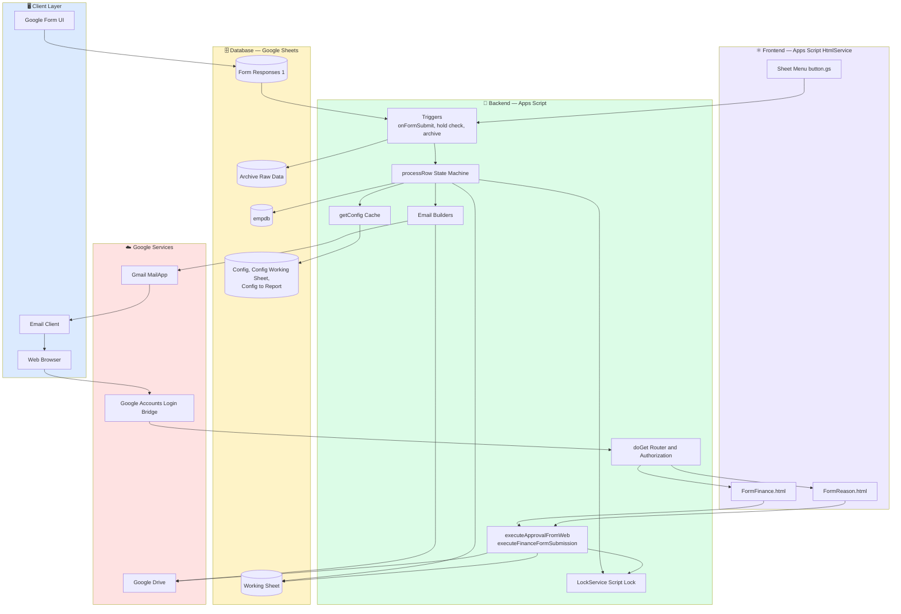

### Data Flow — Core Request Cycle

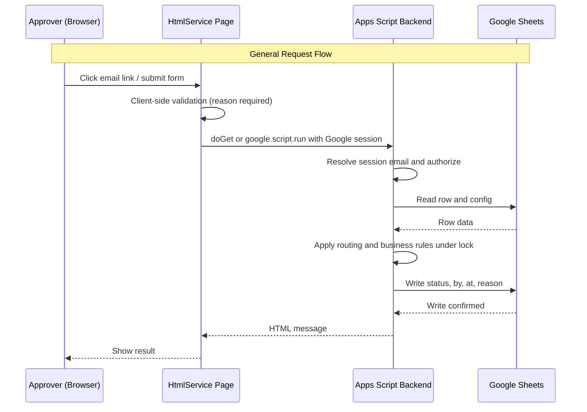

---

## 9. Database Schema

> The "database" is Google Sheets. Entities below are logical tables; the physical mapping is given in Table Descriptions. Sheet headers are matched case-insensitively after trimming, and column names are configurable via `Config`.

### Entity Relationship Diagram (ERD)

```mermaid
erDiagram
    employee {
        string email PK
        string employee_name
        string position
        string department
        string manager_name
        string l2_manager
        string manager_email
        string l2_manager_email
        string employment_status
    }

    form_response {
        string response_id PK
        datetime timestamp
        string email_address FK
        string full_name
        number total_requested
        string overlimit_reason
        string reason_detail
        string attachment_urls
        string status_to_working_sheet "DONE or empty"
    }

    request {
        string request_id PK
        string response_id FK
        string email_address FK
        string company
        number total_requested
        number limit_amount
        number current_usage
        string status "empty or HOLD or REJECTED or DONE"
        datetime hold_reminder_at
        string move_to_report "DONE or empty"
    }

    approval_step {
        string step_id PK
        string request_id FK
        string level "HR or L1 or L2"
        string status "SENT TO HR or APPROVE or REJECT or HOLD or BYPASSED or SUPPORT SUPER ADMIN"
        datetime decided_at
        string decided_by
        string reason
    }

    finance_disbursement {
        string disbursement_id PK
        string request_id FK
        string bank_name
        string account_no
        string account_holder
        string receipt_url
        date due_date
        string sent_to_finance "DONE or empty"
    }

    app_config {
        string config_key PK
        string config_value
    }

    field_mapping {
        string target_header PK
        string source_header
        string source_sheet
        string formula
    }

    report_mapping {
        string target_header PK
        string source_header
    }

    employee ||--o{ form_response : "submits"
    form_response ||--o| request : "becomes"
    employee ||--o{ request : "owns"
    request ||--|{ approval_step : "has up to 3"
    request ||--o| finance_disbursement : "paid by"
    field_mapping }o--|| request : "populates"
    report_mapping }o--|| request : "archives"
    app_config }o--|| approval_step : "names columns and approvers"
```

### Table Descriptions

| Table | Description | Key Columns |
|-------|-------------|-------------|
| **employee** | Sheet `empdb`: master data for lookup by email (manager chain, department, employment status). Bank fields used by Finance are expected here or in formulas (Q-03) | `Email Address` (unique) |
| **form_response** | Sheet `Form Responses 1`: raw, append-only Form output; `status to working sheet` guards against double copy | `Timestamp`, `status to working sheet` |
| **request** | Sheet `Working Sheet`: one row per request; also holds the flattened approval and finance columns. `request_id` is proposed (F-11); today the row number is the identifier | `Status`, `Move to report`, `Limit`, `Current Usage` |
| **approval_step** | Logical entity stored as column groups on `Working Sheet`: `Approval {HR/L1/L2}`, `… at`, `… by`, `Reason By {…}` | level status, `Approval L2` bypass values |
| **finance_disbursement** | Logical entity stored as columns: `Sent to Finance`, `Lampiran ke Finance`, `Due Date Finance`, plus bank columns | `Sent to Finance` |
| **app_config** | Sheet `Config`: key/value (column B, fallback column C). Keys: `HEADER_*` column names, `EMAIL_HR`, `EMAIL_FINANCE`, `EMAIL_SUPER_ADMIN`, `CC_HR`, `CC_L1`, `CC_L2`, `CC_ALL_HR_ADMIN` | `config_key` |
| **field_mapping** | Sheet `Config Working Sheet`: how each Working Sheet column is filled (Form, `empdb` or formula with `{row}`, `{email_col}`) | `Target Header` |
| **report_mapping** | Sheet `Config to Report`: archive column mapping | `Target Header` |
| **archive** | Separate spreadsheet, sheet `Raw Data Overlimit Reimbursement` | mapped headers |

### Indexing Strategy
Google Sheets has no indexes. Lookups are linear scans (`empdb` by email, Working Sheet by employee name for history, hold scan by `Status`). The strategy is therefore (1) keep the Working Sheet small by archiving, (2) read ranges in one call, and (3) use the SQL below if the data is ever migrated to a relational store.

```sql
-- Target relational mirror (only if migrated); each index maps to a query used today
CREATE UNIQUE INDEX idx_employee_email        ON employee(lower(email));             -- empdb lookup on submit
CREATE INDEX idx_request_employee_month       ON request(email_address, created_at); -- L2 month-to-date history table
CREATE INDEX idx_request_status               ON request(status);                    -- hold reminder and pending sync scans
CREATE INDEX idx_request_move_to_report       ON request(move_to_report, status);    -- archive selection (DONE and not moved)
CREATE UNIQUE INDEX idx_approval_step_level   ON approval_step(request_id, level);   -- one decision per level
CREATE UNIQUE INDEX idx_finance_request       ON finance_disbursement(request_id);   -- submit-once guard
```

---

## 10. API Endpoints

> The system exposes one Apps Script Web App (deployment: execute as owner, access "Anyone with Google account") and two server functions called from the HTML pages with `google.script.run`. Responses are currently HTML fragments, not JSON; the JSON shapes below describe the request payloads and the logical result.

### Web App Routes (`doGet`)
| Method | Endpoint | Description | Auth |
|--------|----------|-------------|------|
| `GET` | `{WEB_APP_URL_RAW}?row={n}&level={HR\|L1\|L2}&action=approve` | Open decision form to approve | ✅ Google session + approver match |
| `GET` | `{WEB_APP_URL_RAW}?row={n}&level={HR\|L1\|L2}&action=reject` | Open decision form to reject | ✅ |
| `GET` | `{WEB_APP_URL_RAW}?row={n}&level=HR&action=hold` | Open decision form to hold (HR link only) | ✅ |
| `GET` | `{WEB_APP_URL_RAW}?row={n}&level=FINANCE&action=finance_form` | Open Finance disbursement form | ✅ Google session (see Q-04) |

### Server Functions (`google.script.run`)
| Method | Function | Description | Auth |
|--------|----------|-------------|------|
| `RPC` | `executeApprovalFromWeb(data)` | Persist approve / reject / hold, trigger routing | ✅ session email → Super Admin check |
| `RPC` | `executeFinanceFormSubmission(data)` | Store receipt, compute due date, email Finance | ✅ |

### Triggers & Menu Entrypoints
| Method | Function | Description | Auth |
|--------|----------|-------------|------|
| `TRIGGER` | `onFormSubmit(e)` | Intake and routing on new response | Script owner |
| `TRIGGER / MENU` | `cekReminderHold()` | Re-open HOLD requests whose date arrived | Script owner / System Owner |
| `TRIGGER / MENU` | `moveWorkingDataToRawData()` | Archive DONE rows | Script owner / System Owner |
| `MENU` | `runManualForAllPending()`, `resendRejectEmailViaPrompt()` | Recovery | System Owner |

### Finance SLA Calendar (computed in `executeFinanceFormSubmission`)
| Submit time (GMT+7) | Due date |
|---|---|
| Monday 16:00 → Thursday 15:59 | Following Tuesday |
| Thursday 16:00 → Monday 15:59 | Following Thursday |

### Example Request & Response

**RPC `executeApprovalFromWeb`**
```json
// Request
{
  "row": 12,
  "level": "HR",
  "action": "approve",
  "reason": "Receipts verified, amount corrected per nota",
  "newNominal": "850.000",
  "holdDate": "",
  "fileBase64": "",
  "fileMimeType": "",
  "fileName": ""
}

// Response (current): HTML string
"<h3 style='color:#28a745;'>✔️ Sukses! Aksi APPROVE berhasil dicatat.</h3>"

// Response (current, error cases): HTML string, mapped to proposed error codes
// LOCK_TIMEOUT      -> "❌ Sistem sibuk, coba beberapa saat lagi."
// ROW_NOT_FOUND     -> "❌ Gagal: Data sudah dihapus dari sistem."
// INTERNAL_ERROR    -> "❌ Terjadi kesalahan sistem internal."
```

**RPC `executeFinanceFormSubmission`**
```json
// Request
{
  "row": 12,
  "base64": "<file bytes base64>",
  "mimeType": "application/pdf",
  "fileName": "transfer.pdf",
  "logApproval": "HR Approved: hr@company.com at 15 Oct 2026 09:10 (OK)\nL1 Approved: ...\nL2 Approved: ..."
}

// Response (current success): HTML string
"<h3 style='color:#28a745;'>✔️ Pengajuan Berhasil Disubmit ke Finance! (Due Date: Tue, 20 Oct 2026)</h3>"

// Response (current error): HTML string
// ALREADY_SENT      -> "❌ Gagal: Data sudah dikirim ke Finance."
// FINANCE_EMAIL_MISSING -> "❌ Konfigurasi email Finance tidak ditemukan."
```

**Proposed target contract (F-11)**
```json
// Success
{ "success": true, "data": { "request_id": "b6f1…", "level": "HR", "status": "APPROVE" }, "meta": { "next_level": "L1" } }

// Error
{ "success": false, "error": { "code": "NOT_AUTHORIZED", "message": "Signed-in account is not the approver for this level" } }
```

---

## 11. Design & Technical Constraints

### Technology Stack
| Layer | Technology Choice | Reason |
|-------|-------------------|--------|
| **Frontend** | Apps Script HtmlService (HTML + inline CSS + `google.script.run`) | No hosting; same origin as backend; Google session available |
| **Backend** | Google Apps Script (V8 JavaScript) | Serverless, free tier, native access to Sheets, Gmail, Drive |
| **Database** | Google Sheets | Non-technical admins can edit config and data; no infrastructure |
| **Intake** | Google Forms | File upload and email collection built in |
| **Auth** | Google account session via Web App ("Anyone with Google account") | No custom login; identity provided by Google |
| **Notifications** | `MailApp` with optional send-as alias | Native, no SMTP setup |
| **File storage** | Google Drive folders (attachments, receipts, Super Admin evidence) | Same permission model as Sheets |
| **Deployment** | Apps Script Web App + installable triggers | Zero cost; `clasp` recommended for source control (see Q-10) |

### Typography Rules
**Pending.** No font configuration has been supplied or approved. The current UI and emails use inline `Arial, sans-serif`. The template's sample font table is intentionally not carried over. Decision logged in Q-11.

| Role | Font Stack |
|------|-----------|
| **Sans** | Pending (current: `Arial, sans-serif`) |
| **Serif** | Pending |
| **Mono** | Pending |

### Coding Standards
- **Language:** JavaScript (Apps Script V8); proposed migration to TypeScript via `clasp` + `@types/google-apps-script`
- **Configuration over code:** column names and recipients live in `Config`; no hard-coded IDs (the folder IDs, Web App URL and company aliases currently hard-coded must move to `Config`/Script Properties)
- **Linting:** ESLint + Prettier
- **Testing:** Unit tests for routing (`_processRowInternal` rules) and SLA date calculation; manual UAT script for each level and bypass case
- **Git branching:** `main` (released), `develop`, `feature/*`
- **Commit format:** Conventional Commits (`feat:`, `fix:`, `docs:`)
- **Language of UI strings:** Indonesian (current); i18n out of scope for MVP

### Security Constraints
- Authenticate every decision with `Session.getActiveUser().getEmail()`; deny when empty
- Authorise by exact (not substring) email match against the intended approver list; Super Admin list from `Config`
- Never accept state changes via `GET` links alone: every decision requires the reason form submit
- Replace row-number links with unguessable Request ID (F-11); consider a signed one-time token per link
- Sheet edit access restricted to System Owner(s); protect formula and status columns with range protection
- Drive folders private to the script owner; share files only through links in the email
- Secrets and IDs (folder IDs, Web App URL) in Script Properties, not source
- Escape user-provided text (name, reason, detail) before inserting into HTML emails and pages to prevent HTML injection
- Retain an append-only audit log; no deletion of decision history
- Controls aligned with ISO/IEC 27001 Annex A access control and logging principles (A.5.15, A.8.15) as guidance, not a certification claim

---

## 12. Out of Scope

The following features are **not included** in this version (MVP):

| Feature | Reason for Exclusion | Possible Version |
|---------|----------------------|-----------------|
| Native mobile app | Email and responsive web pages are sufficient | v3.0 |
| Migration to a relational database / standalone web app | Contradicts the zero-infrastructure positioning | v2.0 |
| SSO (SAML/OIDC) beyond Google accounts | Google identity is the assumed standard | v2.5 |
| Payment execution / bank API integration | Finance disburses manually and uploads proof | v2.0 |
| Parallel or conditional approval chains beyond HR → L1 → L2 | Current rules cover the known policy | v2.0 |
| Multi-language UI | Indonesian UI is acceptable for current users | v2.0 |
| Delegation / out-of-office routing | Super Admin override covers the need | v1.5 |
| Dashboard / analytics UI | Archive spreadsheet can feed any BI tool | v1.5 |
| WhatsApp / Slack notifications | Email is the single channel | v2.0 |

---

## 13. Risks & Mitigations

| ID | Risk | Impact | Likelihood | Mitigation |
|----|------|--------|------------|------------|
| R-01 | Links use the sheet row number; deleting or sorting rows makes a link point to a different request | 🔴 High | 🟡 Medium | Introduce Request ID (F-11); lock/protect the sheet against sort and delete |
| R-02 | Anyone with sheet edit access can alter statuses and bypass approval | 🔴 High | 🟡 Medium | Restrict edit access; protected ranges; append-only Audit Log; periodic review of edit history |
| R-03 | Missing or wrong manager email leaves a request waiting indefinitely with no alert | 🟠 Medium | 🟡 Medium | Config validation; daily "stuck request" digest to System Owner; `Not Found` count report |
| R-04 | `getActiveUser()` returns empty for some consumer or cross-domain accounts, blocking approvers | 🟠 Medium | 🟡 Medium | Restrict to one Workspace domain; document supported account types; Super Admin fallback |
| R-05 | Email quota or attachment size limits stop approval emails | 🔴 High | 🟡 Medium | Use Workspace account (higher quota); log send failures; retry queue; link attachments instead of embedding |
| R-06 | Hold reminder reads a different column from the one written, so held requests are never re-opened | 🟠 Medium | 🔴 High | Fix column reference and add a test; see Q-06 |
| R-07 | Concurrent submissions or retries cause duplicate processing | 🟠 Medium | 🟢 Low | Script lock + `DONE` guards (implemented); idempotent finance submit |
| R-08 | Hard-coded Drive folder IDs and Web App URL left as placeholders cause silent upload failures | 🟠 Medium | 🟡 Medium | `validateConfig()` before go-live; move to Script Properties |
| R-09 | Unescaped user text inserted into HTML pages and emails (HTML injection) | 🟠 Medium | 🟡 Medium | Escape output; restrict to text-only fields |
| R-10 | Working Sheet growth degrades performance (linear scans; 6-minute execution limit) | 🟠 Medium | 🟡 Medium | Scheduled archive; row limits; batch reads |
| R-11 | Personal and bank data in Sheets/Drive creates privacy and retention obligations | 🔴 High | 🟡 Medium | Access control, retention policy, mask account numbers in emails where possible; align with applicable personal data law (Q-09) |
| R-12 | Dependency on Google platform changes (Apps Script quotas, Web App behaviour, AccountChooser URL) | 🟠 Medium | 🟢 Low | Pin to documented APIs; keep integration surface small; monitor Google release notes |

---

## 14. Timeline & Milestones

> The code baseline (F-01 to F-10) already exists in the repository. The plan below covers verification of the baseline and delivery of the hardening release, with a start on Monday 2026-10-19 (assumption, Q-12).

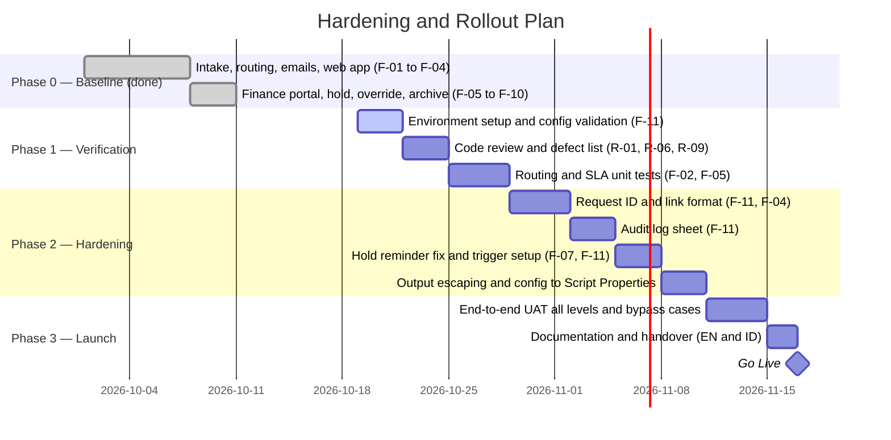

| Milestone | Target Date | Deliverable |
|-----------|-------------|-------------|
| M-01: Kickoff | 2026-10-19 | Final PRD, owners and environment confirmed |
| M-02: Alpha | 2026-11-03 | Baseline verified, test suite for routing and SLA |
| M-03: Beta | 2026-11-17 | Hardening complete (Request ID, audit log, triggers) |
| M-04: UAT | 2026-11-24 | End-to-end tests with HR, managers, Finance |
| M-05: Go Live | 2026-11-30 | Production deployment and handover |

---

## 15. Open Questions

Questions and assumptions that need confirmation before or during development. Rows Q-01 to Q-03 and Q-08 to Q-12 are assumptions made because the user did not provide the detail.

| ID | Question | Directed To | Deadline | Status |
|----|----------|-------------|----------|--------|
| Q-01 | **Assumption:** the PRD documents the current implementation and proposes hardening, rather than a new product. Is that the intended scope? | Requester | 2026-10-21 | ⏳ Pending |
| Q-02 | **Assumption:** KPI targets in Section 2 (≤ 2 working days, ≥ 95% by due date) are proposals. What targets and baselines does the business use? | Stakeholder | 2026-10-28 | ⏳ Pending |
| Q-03 | **Assumption:** bank and company columns used by the Finance form (`Company`, `Nama Bank`, `No Rekening`, `Nama Pemilik Rekening`, `Region`, `Limit`, `Current Usage`) come from `empdb` formulas or Form fields not shipped in `templates/`. What are the real source and formulas? | System Owner | 2026-10-28 | ⏳ Pending |
| Q-04 | The Finance link is sent to `EMAIL_HR` and the finance form route does not check the approver's identity. Should it be restricted to Finance accounts? | Stakeholder / Security | 2026-10-28 | ⏳ Pending |
| Q-05 | Missing `Limit` or `Current Usage` is parsed as 0, so a blank limit makes every request overlimit. Is this the intended policy? | Product Owner | 2026-10-28 | ⏳ Pending |
| Q-06 | `cekReminderHold` reads the reminder date from the `HEADER_HR_AT` column while the hold writes `Tgl Reminder Hold`. Is this a defect? (assumed yes) | System Owner | 2026-10-26 | ⏳ Pending |
| Q-07 | Super Admin decision is recorded even if the evidence upload fails or the folder ID is a placeholder. Should evidence be mandatory? | Stakeholder / Audit | 2026-10-28 | ⏳ Pending |
| Q-08 | **Assumption:** only the System Owner has edit access to the Working Sheet; HR/Finance work through emails and forms. Correct? | System Owner | 2026-10-26 | ⏳ Pending |
| Q-09 | **Assumption:** no specific retention period or personal-data regulation is specified. Which policy applies (e.g. Indonesian PDP Law, company retention)? | Legal / HR | 2026-11-03 | ⏳ Pending |
| Q-10 | **Assumption:** source will be managed with `clasp` and Git; deployment by the System Owner. Is a staging spreadsheet available? | System Owner | 2026-10-28 | ⏳ Pending |
| Q-11 | Typography is not specified. Keep Arial or adopt a brand font? | Design / Stakeholder | 2026-11-03 | ⏳ Pending |
| Q-12 | **Assumption:** project start 2026-10-19 and go-live 2026-11-30; no fixed deadline or budget was provided. | Requester | 2026-10-21 | ⏳ Pending |
| Q-13 | The README says to edit `Main.gs`, but the file is `code.gs`, and the `Working Sheet` and `Config` templates are not in `templates/`. Should the repo ship them? | Maintainer | 2026-10-28 | ⏳ Pending |
| Q-14 | L1 `BYPASSED` is accepted by the router but never set by code. Is a manual or formula-based L1 bypass a supported use case? | Product Owner | 2026-10-28 | ⏳ Pending |
| Q-15 | Hard-coded company logic (`company a` normal flow, alias addresses) must be generalised. What is the intended rule set per company? | Stakeholder | 2026-10-28 | ⏳ Pending |

---

## Changelog

| Version | Date | Changes | Author |
|---------|------|---------|--------|
| 1.0.0 | 2026-10-17 | Initial document created from repository analysis | indarto.b@gmail.com |

---

*This is a living document — it will be continuously updated as the project evolves. All significant changes must be recorded in the Changelog.*
