# PRD — Open Source Serverless Approval System (Reimbursement Overlimit)
> **Version:** 1.0.0 | **Status:** 🟡 Draft | **Last Updated:** 2026-10-17  
> **Author:** indarto.b@gmail.com (peminta) | **Reviewer:** [TBD] | **Stakeholder:** [TBD]

---

## Table of Contents
1. [Overview](#1-overview)
2. [Goals & Success Metrics](#2-goals--success-metrics)
3. [Requirements](#3-requirements)
4. [Core Features](#4-core-features)
5. [User Roles & Permissions](#5-user-roles--permissions)
6. [User Flow](#6-user-flow)
7. [Screen & UI Breakdown](#7-screen--ui-breakdown)
8. [Architecture](#8-architecture)
9. [Database Schema](#9-database-schema)
10. [API Endpoints](#10-api-endpoints)
11. [Design & Technical Constraints](#11-design--technical-constraints)
12. [Out of Scope](#12-out-of-scope)
13. [Risks & Mitigations](#13-risks--mitigations)
14. [Timeline & Milestones](#14-timeline--milestones)
15. [Open Questions](#15-open-questions)

> **Dasar dokumen ini:** hasil analisis balik (reverse-engineering) repositori `Yuin-Labs/open-source-approval-system` (commit `6c7ba59`, 2026-10-10: `src/code.gs`, `report.gs`, `button.gs`, `FormReason.html`, `FormFinance.html`, `templates/*.csv`, `README.md`). Fitur bertanda ✅ Selesai sudah ada di kode; item 🔲 adalah pekerjaan hardening yang diusulkan dalam PRD ini. Seluruh asumsi dicatat di [Bagian 15](#15-open-questions).

---

## 1. Overview

### Problem Statement
> *Jelaskan masalah inti yang diselesaikan. Siapa yang terdampak, dan apa akibatnya jika tidak diselesaikan?*

Karyawan mengajukan reimbursement yang melebihi limit pengeluaran bulanan ("overlimit"). Tanpa sistem, pengajuan berpindah lewat chat dan email, tanpa rantai persetujuan baku (HR → Atasan Langsung → Head Business → Finance), tanpa bukti siapa menyetujui apa dan kapan, dan tanpa eskalasi otomatis saat nominal melewati limit. HR dan Finance menginput ulang data secara manual, approver memutuskan tanpa melihat riwayat pengajuan bulan berjalan, dan Finance tidak bisa memprediksi kapan pembayaran jatuh tempo. Jika dibiarkan, perusahaan menghadapi celah audit trail, pembayaran ganda atau tidak sah, serta siklus reimbursement yang lama dan tidak terprediksi. Perusahaan kecil-menengah juga sering tidak membenarkan biaya platform workflow khusus atau server.

### Solution Summary
> *Ringkasan solusi dalam 2–3 kalimat.*

Mesin approval serverless yang sepenuhnya berjalan di Google Workspace (Google Forms, Sheets, Apps Script, Gmail, Drive). Respons Form diperkaya dengan data master karyawan, diarahkan melalui tingkat persetujuan HR → L1 → L2 yang dapat dikonfigurasi (L2 dilewati otomatis atau dieskalasi berdasarkan deteksi overlimit), dan diputuskan lewat tautan email satu klik yang membuka Web App terautentikasi. Setelah disetujui penuh, Finance mendapat portal pencairan untuk mengunggah bukti transfer, tanggal jatuh tempo dihitung dari kalender SLA tetap, dan data selesai diarsipkan ke spreadsheet pelaporan.

### Target Users
| Persona | Deskripsi | Kebutuhan Utama |
|---------|-----------|-----------------|
| Requester (Karyawan / mantan karyawan) | Staf yang mengajukan reimbursement overlimit via Google Form | Mengajukan sekali, tahu statusnya, dibayar pada tanggal yang jelas |
| HR Verifier | Admin HR yang melakukan verifikasi awal nota dan nominal | Melihat konteks lengkap dalam satu email, mengoreksi nominal, hold atau reject dengan alasan |
| Approver L1 (Atasan Langsung) | Manajer dari requester | Approve atau reject pengajuan tim dengan cepat dari email |
| Approver L2 (Head Business) | Manajer senior, hanya terlibat untuk pengajuan overlimit atau perusahaan tertentu | Melihat riwayat pengajuan bulan berjalan sebelum memutuskan |
| Finance Officer | Pihak yang mencairkan reimbursement | Hanya menerima pengajuan yang disetujui penuh lengkap dengan data bank, log approval, dan due date |
| Super Admin | Approver pengganti yang ditunjuk (misal saat approver berhalangan) | Memutuskan atas nama level mana pun, dengan bukti wajib dan label audit |
| System Owner (Admin Spreadsheet) | Pemilik Sheet, Script, Config, dan trigger | Mengatur routing dan mapping tanpa mengubah kode; menjalankan sync manual, kirim ulang, dan arsip |

---

## 2. Goals & Success Metrics

### Business Goals
- [ ] Mengarahkan 100% pengajuan reimbursement overlimit melalui rantai approval yang ditetapkan tanpa forward manual
- [ ] Menjaga jejak keputusan yang lengkap dan sulit dimanipulasi (approver, waktu, alasan) untuk setiap pengajuan
- [ ] Mengurangi input manual HR dan Finance dengan mengisi otomatis data karyawan, atasan, dan bank dari data master
- [ ] Memberi Finance due date pencairan yang pasti untuk setiap pengajuan yang disetujui
- [ ] Berjalan tanpa biaya infrastruktur dan tanpa server yang harus dirawat

### Key Performance Indicators (KPIs)
| Metric | Current Baseline | Target | How to Measure |
|--------|-----------------|--------|----------------|
| Median waktu siklus approval (submit form → approval final) | Tidak ada (proses baru); ditangkap 4 minggu pertama setelah go-live | ≤ 2 hari kerja | `Timestamp` terhadap `Approval … at` terakhir di Working Sheet |
| Pengajuan dengan log keputusan lengkap (status + by + at + alasan di tiap level aktif) | Tidak ada (proses baru) | 100% | Query audit pada arsip `Raw Data` |
| Pengajuan yang butuh intervensi manual (sync manual, kirim ulang, override Super Admin) | Tidak ada (proses baru) | < 5% dari pengajuan | Jumlah status `SUPPORT SUPER ADMIN` + eksekusi lewat menu |
| Pencairan Finance selesai sebelum due date | Tidak ada (proses baru) | ≥ 95% | `Due Date Finance` dibanding tanggal transfer di catatan Finance |
| Pengajuan tertahan di HOLD melewati tanggal reminder | Tidak ada (proses baru) | 0 | Hitungan harian `Status = HOLD` dengan tanggal reminder yang sudah lewat |

---

## 3. Requirements

### Functional Requirements
| ID | Category | Requirement | Priority |
|----|----------|-------------|----------|
| FR-01 | Intake | Setiap respons Google Form disalin ke Working Sheet tepat satu kali, memakai mapping kolom di `Config Working Sheet` | 🔴 Must Have |
| FR-02 | Intake | Data karyawan (posisi, departemen, atasan L1/L2 beserta email, status kepegawaian) dicari dari `empdb` berdasarkan email; field yang tidak ditemukan diisi `Not Found` | 🔴 Must Have |
| FR-03 | Routing | Sistem mengarahkan setiap pengajuan HR → L1 → L2 dan hanya maju bila level sebelumnya disetujui | 🔴 Must Have |
| FR-04 | Routing | L2 dilewati otomatis bila (a) perusahaan memakai alur normal dan pengajuan tidak overlimit, atau (b) tidak ada manajer L2; kasus lain diteruskan ke L2 | 🔴 Must Have |
| FR-05 | Routing | Overlimit terdeteksi bila `Current Usage` > `Limit` (nilai di-parse dari teks numerik) | 🔴 Must Have |
| FR-06 | Notifikasi | Email approval berisi detail pengajuan, lampiran, serta tautan Approve / Reject (dan Hold untuk HR) | 🔴 Must Have |
| FR-07 | Otorisasi | Keputusan hanya diterima dari akun Google approver yang berwenang atau Super Admin | 🔴 Must Have |
| FR-08 | Keputusan | Setiap keputusan mencatat status, waktu, approver, dan alasan wajib | 🔴 Must Have |
| FR-09 | Keputusan | Keputusan yang sudah tersimpan tidak dapat diubah melalui Web App | 🔴 Must Have |
| FR-10 | Keputusan | HR dapat mengubah nominal pengajuan saat approve | 🟠 Should Have |
| FR-11 | Finance | Setelah approval penuh, Finance menerima tautan form pencairan yang menampilkan data bank, nominal, dan log approval serta menerima unggahan bukti transfer | 🔴 Must Have |
| FR-12 | Finance | Sistem menghitung due date Finance dari waktu submit memakai kalender SLA Selasa/Kamis dan menyimpannya | 🔴 Must Have |
| FR-13 | Finance | Satu pengajuan hanya dapat dikirim ke Finance sekali (`Sent to Finance = DONE`) | 🔴 Must Have |
| FR-14 | Notifikasi | Requester menerima email saat approval final dan saat penolakan (beserta alasan level yang menolak) | 🟠 Should Have |
| FR-15 | Hold | HR dapat menahan pengajuan (HOLD) dengan tanggal reminder; pengecekan terjadwal membuka kembali tahap HR saat tanggal tiba | 🟠 Should Have |
| FR-16 | Override | Super Admin dapat approve atau reject di level mana pun; bukti diminta dan status diberi label `SUPPORT SUPER ADMIN` | 🟠 Should Have |
| FR-17 | Pelaporan | Baris selesai (`DONE`) disalin satu kali ke spreadsheet arsip memakai mapping `Config to Report` | 🟠 Should Have |
| FR-18 | Operasional | Menu spreadsheet menyediakan sync manual, cek hold, kirim ulang email penolakan, dan arsip | 🟠 Should Have |
| FR-19 | Konkurensi | Pembuatan baris, routing, dan keputusan berjalan di bawah script lock untuk mencegah pemrosesan ganda | 🔴 Must Have |
| FR-20 | Hardening | Pengajuan diidentifikasi dengan Request ID yang stabil, bukan nomor baris sheet | 🟠 Should Have |
| FR-21 | Hardening | Sheet audit log append-only mencatat setiap perubahan status dan email yang dikirim | 🟠 Should Have |
| FR-22 | Hardening | Trigger berbasis waktu untuk hold reminder dan arsip terdokumentasi dan dibuat oleh fungsi setup | 🟡 Nice to Have |

**Priority Legend:**
- 🔴 **Must Have** — Wajib ada di MVP, sistem tidak bisa berjalan tanpanya
- 🟠 **Should Have** — Penting namun bisa ditunda ke iterasi berikutnya
- 🟡 **Nice to Have** — Meningkatkan pengalaman namun bukan prioritas utama

### Non-Functional Requirements
| Category | Requirement | Target |
|----------|-------------|--------|
| **Performance** | Waktu muat halaman keputusan dan respons submit | < 5 detik (termasuk cold start Apps Script) |
| **Performance** | Satu eksekusi Apps Script | < 6 menit (batas platform); tunggu lock ≤ 15–20 detik |
| **Accessibility** | Platform yang didukung | Browser dan email client modern (desktop dan mobile) |
| **Security** | Metode autentikasi | Sesi akun Google (Web App "Anyone with Google account") + pencocokan email approver |
| **Security** | Residensi / akses data | Data tetap di Google Workspace pemilik; Sheet hanya dibagikan ke System Owner |
| **Scalability** | Jumlah pengguna / volume | Hingga ~500 karyawan dan ~1.000 pengajuan/bulan; ≤ 10.000 baris Working Sheet sebelum diarsipkan |
| **Availability** | Uptime | Mengikuti SLA Google Workspace (≥ 99,9%); tidak ada komponen self-hosted |
| **Auditability** | Jejak keputusan | 100% keputusan memiliki by / at / alasan; retensi arsip sesuai kebijakan perusahaan (lihat Q-09) |
| **Quota** | Email keluar | Dalam kuota harian Gmail/Apps Script (lihat R-05) |

---

## 4. Core Features

### Feature List

| ID | Feature | Brief Description | Priority | Status |
|----|---------|-------------------|----------|--------|
| F-01 | Intake Pengajuan & Pengayaan Data | Respons Form → Working Sheet dengan mapping berbasis config dan lookup `empdb` | 🔴 Must Have | ✅ Selesai |
| F-02 | Routing Approval Bertingkat | State machine HR → L1 → L2 dengan bypass/eskalasi L2 berdasarkan overlimit | 🔴 Must Have | ✅ Selesai |
| F-03 | Email Approval Interaktif | Email berisi detail, tabel riwayat, lampiran, dan tautan satu klik | 🔴 Must Have | ✅ Selesai |
| F-04 | Web App Keputusan Terautentikasi | Form alasan, otorisasi approver, keputusan tidak dapat diubah | 🔴 Must Have | ✅ Selesai |
| F-05 | Portal Pencairan Finance | Unggah bukti, due date SLA, email ke Finance | 🔴 Must Have | ✅ Selesai |
| F-06 | Notifikasi Requester | Email approval final dan penolakan; kirim ulang penolakan | 🟠 Should Have | ✅ Selesai |
| F-07 | Hold & Reminder | HOLD oleh HR dengan tanggal reminder dan pembukaan ulang terjadwal | 🟠 Should Have | ✅ Selesai |
| F-08 | Override Super Admin | Memutuskan atas nama level mana pun dengan bukti | 🟠 Should Have | ✅ Selesai |
| F-09 | Arsip Pelaporan | Memindahkan baris `DONE` ke spreadsheet arsip | 🟠 Should Have | ✅ Selesai |
| F-10 | Menu Admin & Sync Manual | Menu spreadsheet untuk operasi pemulihan | 🟠 Should Have | ✅ Selesai |
| F-11 | Hardening: Request ID, Audit Log, Setup Trigger | ID stabil, log append-only, trigger terprovisi, validasi config | 🟠 Should Have | 🔲 Belum Mulai |

**Status Legend:** 🔲 Belum Mulai | 🔵 In Progress | ✅ Selesai | ❌ Dibatalkan

---

### F-01: Intake Pengajuan & Pengayaan Data
> Mengubah respons Google Form mentah menjadi baris Working Sheet yang ternormalisasi dan diperkaya dari master karyawan, sehingga approver dan Finance tidak perlu input ulang.

**User Story:**
> Sebagai `Requester`, saya ingin `mengajukan satu form berisi nominal, alasan, dan lampiran`, agar saya dapat `memulai approval tanpa menghubungi HR secara manual`.

**Acceptance Criteria:**
- [ ] Saat form disubmit (installable trigger `onFormSubmit`), baris baru ditambahkan ke Working Sheet dan baris Form Responses diberi tanda `status to working sheet = DONE`
- [ ] Setiap kolom Working Sheet yang tercantum di `Config Working Sheet` diisi dari `Form Responses 1`, dari `empdb`, atau dari formula yang mendukung placeholder `{row}` dan `{email_col}`
- [ ] Lookup karyawan tidak peka huruf besar/kecil dan email di-trim
- [ ] Memproses ulang baris yang sudah `DONE` tidak membuat duplikat
- [ ] `Sync Manual (Pending Rows)` memproses setiap respons yang belum bertanda dan setiap baris Working Sheet yang belum final

**Edge Cases & Error Handling:**
- Jika email requester tidak ada di `empdb` → Sistem harus mengisi kolom turunan karyawan dengan `Not Found` dan tetap membuat baris
- Jika script lock tidak didapat dalam 15 detik → Sistem harus berhenti tanpa error dan membiarkan respons tidak bertanda agar diambil oleh sync manual
- Jika header target di `Config Working Sheet` tidak ada di Working Sheet → Sistem harus melewati baris mapping tersebut tanpa menggagalkan proses
- Jika respons yang sama diproses dua kali (retry trigger) → Sistem harus mendeteksi `DONE` dan keluar tanpa menulis
- Jika terjadi exception tak terduga → Sistem harus mencatat ke console dan membiarkan respons tidak bertanda (lihat F-11 untuk audit log)

---

### F-02: Routing Approval Bertingkat
> State machine atas kolom status HR, L1, dan L2. Dijalankan setelah intake dan setelah setiap keputusan, maksimal 5 iterasi per pemanggilan.

**User Story:**
> Sebagai `HR Verifier`, saya ingin `pengajuan sampai ke approver yang tepat secara berurutan dan dieskalasi saat melewati limit`, agar saya dapat `menegakkan kebijakan tanpa mengejar-ngejar orang`.

**Acceptance Criteria:**
- [ ] Status HR kosong → set `SENT TO HR` dan kirim email ke HR
- [ ] HR `APPROVE` (atau support Super Admin) dan L1 kosong → email ke L1
- [ ] Setelah L1 approve: bila perusahaan alur normal dan `Current Usage ≤ Limit` → L2 diset `BYPASSED (Normal Flow)`; bila manajer L2 kosong atau `-` → `BYPASSED (No L2 Data)`; selain itu email ke L2
- [ ] Ketiga level approve/bypass → `Status = DONE`, requester dan Finance diberi notifikasi tepat satu kali
- [ ] Level mana pun `REJECT` → `Status = REJECTED`, requester menerima email berisi alasan level yang menolak
- [ ] `Status` bernilai `DONE`, `REJECTED`, atau `HOLD` menghentikan routing

**Edge Cases & Error Handling:**
- Jika `Current Usage` atau `Limit` kosong atau non-numerik → Sistem harus memperlakukan nilainya 0 (lihat Q-05)
- Jika email manajer suatu level kosong → Sistem tidak boleh mengirim dan membiarkan baris menunggu (terlihat oleh admin lewat sync manual; lihat R-03)
- Jika keputusan datang untuk level yang level sebelumnya belum disetujui → Sistem harus menolak dengan halaman "menunggu level sebelumnya"
- Jika routing terpicu bersamaan oleh submit form dan keputusan → Sistem harus menserialisasi lewat script lock (tunggu 20 detik)

---

### F-03: Email Approval Interaktif
> Email HTML per level dengan tabel detail, lampiran, dan tautan aksi yang aman.

**User Story:**
> Sebagai `Approver L1`, saya ingin `melihat pengajuan dan approve atau reject dari email`, agar saya dapat `memutuskan dalam kurang dari satu menit`.

**Acceptance Criteria:**
- [ ] Email menampilkan timestamp (GMT+7), nama, ID karyawan, posisi, nominal pengajuan, limit, pemakaian bulan berjalan, alasan, detail, dan tautan lampiran
- [ ] File pendukung dari Drive dilampirkan ke email bila dapat dibaca
- [ ] Tautan Approve dan Reject untuk semua level; tautan Hold hanya untuk HR
- [ ] Tautan melewati Google AccountChooser agar approver login sebelum Web App terbuka
- [ ] Email L2 overlimit menyertakan tabel pengajuan requester yang tidak ditolak pada bulan yang sama, dengan baris saat ini disorot dan total; L1 dan HR di-CC sesuai config

**Edge Cases & Error Handling:**
- Jika email penerima tidak dapat ditentukan → Sistem tidak boleh memanggil MailApp dan keluar tanpa error
- Jika lampiran Drive tidak dapat dibaca → Sistem tetap mengirim email hanya dengan tautan
- Jika kuota email habis → Sistem harus menampilkan kegagalan (lihat audit log F-11; R-05)
- Jika perusahaan memiliki konfigurasi alias → Sistem harus mengirim dari alias dengan nama pengirim yang dikonfigurasi

---

### F-04: Web App Keputusan Terautentikasi
> `doGet` memvalidasi permintaan, `FormReason.html` mengumpulkan alasan, `executeApprovalFromWeb` menyimpan keputusan.

**User Story:**
> Sebagai `Approver L2`, saya ingin `mengonfirmasi keputusan saya beserta alasan`, agar saya dapat `meninggalkan justifikasi yang dapat diaudit`.

**Acceptance Criteria:**
- [ ] `row`, `level`, `action` wajib ada semua; jika tidak, halaman error ditampilkan
- [ ] Email Google yang login harus sama dengan approver yang berwenang untuk level tersebut (HR dari config, L1/L2 dari baris) kecuali termasuk `EMAIL_SUPER_ADMIN`
- [ ] Alasan wajib diisi; Hold juga mewajibkan tanggal-jam reminder
- [ ] Jika level sudah berstatus `APPROVE`, `REJECT`, atau `BYPASSED`, halaman menyatakan keputusan tidak dapat diubah
- [ ] HR yang approve dapat mengubah nominal; nominal baru menggantikan `Total Pengajuan`
- [ ] Approve yang berhasil langsung memicu routing ke level berikutnya

**Edge Cases & Error Handling:**
- Jika email sesi Google kosong → Sistem harus menampilkan "Sesi Google tidak terdeteksi" dan tidak mencatat apa pun
- Jika pengguna login bukan approver yang berwenang dan bukan Super Admin → Sistem harus menampilkan "Akses ditolak"
- Jika baris tidak lagi memiliki nama karyawan → Sistem harus menampilkan "Data tidak ditemukan / dihapus"
- Jika eksekusi lain memegang lock lebih dari 15 detik → Sistem harus menampilkan "Sistem sibuk, coba lagi"
- Jika tautan yang sama dibuka dua kali → Sistem harus menampilkan "keputusan sudah tersimpan"

---

### F-05: Portal Pencairan Finance
> Dibuka dari email approval penuh yang dikirim ke `EMAIL_HR`; Finance mengunggah bukti transfer dan sistem mengirim email ke Finance dengan due date SLA.

**User Story:**
> Sebagai `Finance Officer`, saya ingin `melihat data bank, nominal, dan log approval, lalu mengunggah bukti transfer`, agar saya dapat `menutup pengajuan dengan bukti`.

**Acceptance Criteria:**
- [ ] Portal menampilkan perusahaan, nama, nama bank, nomor rekening, pemilik rekening, region, kode divisi, nominal, dan log approval HR/L1/L2
- [ ] Unggahan menerima gambar atau PDF dan menyimpannya di folder Drive yang dikonfigurasi; URL ditulis ke `Lampiran ke Finance`
- [ ] Email ke `EMAIL_FINANCE` berisi nominal, due date, log approval, bukti transfer, dan lampiran asli
- [ ] Due date mengikuti tabel SLA di Bagian 10 dan ditulis ke `Due Date Finance`
- [ ] `Sent to Finance` diset `DONE` setelah email terkirim dan memblokir submit kedua

**Edge Cases & Error Handling:**
- Jika `Sent to Finance = DONE` → Sistem harus menampilkan "sudah dikirim ke Finance" (saat dibuka dan saat submit)
- Jika tidak ada file dipilih atau file tidak terbaca → Sistem harus menampilkan pesan gagal dan tidak menulis apa pun
- Jika `EMAIL_FINANCE` belum dikonfigurasi → Sistem harus menampilkan error konfigurasi dan tidak menandai `DONE`
- Jika ID folder Drive tidak valid → Sistem harus mengembalikan teks error dan tidak menandai `DONE`
- Jika baris sudah dihapus → Sistem harus menampilkan "data hilang"

---

### F-06: Notifikasi Requester
> Email approval final (status: sedang diproses Finance) dan email penolakan (level penolak, alasan, detail asli).

**User Story:**
> Sebagai `Requester`, saya ingin `diberi tahu hasilnya beserta alasannya`, agar saya dapat `memperbaiki dan mengajukan ulang bila perlu`.

**Acceptance Criteria:**
- [ ] Email approval final mencantumkan HR, L1, dan L2 (level yang dilewati ditandai)
- [ ] Email penolakan berisi alasan yang tersimpan untuk level penolak, nominal, tanggal, alasan, dan tautan lampiran
- [ ] Mantan karyawan (status kepegawaian memuat `ex-karyawan`) diemail ke `Requester Email` pribadi
- [ ] Menu `Resent Email Rejection` mengirim ulang untuk nomor baris yang dipilih

**Edge Cases & Error Handling:**
- Jika email requester kosong → Sistem harus melewati tanpa error
- Jika alasan penolakan kosong → Sistem harus mengirim "tidak ada alasan spesifik"
- Jika nomor baris pada prompt kirim ulang tidak valid → Sistem harus menampilkan peringatan dan tidak mengirim apa pun

---

### F-07: Hold & Reminder
> HR dapat menunda pengajuan; proses terjadwal membuka kembali tahap HR.

**User Story:**
> Sebagai `HR Verifier`, saya ingin `menahan pengajuan sampai tanggal tertentu`, agar saya dapat `menunggu dokumen yang kurang tanpa kehilangan pengajuan`.

**Acceptance Criteria:**
- [ ] Hold mengatur `Status = HOLD`, menyimpan tanggal-jam reminder, dan menghentikan routing
- [ ] `cekReminderHold` (menu atau trigger) mengirim ulang email ke HR, mengembalikan status HR ke `SENT TO HR`, dan mengosongkan `Status` serta tanggal setelah tanggal reminder tercapai

**Edge Cases & Error Handling:**
- Jika tanggal reminder kosong pada Hold → Sistem harus menolak submit di form
- Jika tanggal reminder tersimpan bukan tanggal valid → Sistem harus melewati baris tersebut
- Jika kolom reminder yang dikonfigurasi berbeda dari kolom yang ditulis saat keputusan → hold tidak akan pernah dibuka kembali (defect yang diketahui, lihat Q-06)

---

### F-08: Override Super Admin
> Daftar Super Admin yang ditunjuk dapat memutuskan di level mana pun.

**User Story:**
> Sebagai `Super Admin`, saya ingin `memutuskan atas nama approver yang berhalangan dengan bukti`, agar saya dapat `membuka hambatan pengajuan tanpa merusak audit trail`.

**Acceptance Criteria:**
- [ ] Super Admin melihat kolom unggah bukti (PDF/JPG/PNG); file disimpan di folder Drive dan ditautkan sebagai `Support by Super Admin`
- [ ] Teks status menjadi `APPROVE - SUPPORT SUPER ADMIN` atau `REJECTED - SUPPORT SUPER ADMIN`
- [ ] Routing memperlakukan status support sebagai disetujui

**Edge Cases & Error Handling:**
- Jika unggah bukti gagal → Sistem tetap mencatat keputusan dan menandai `Support by Super Admin (Tanpa Lampiran)` (kelemahan yang diketahui; lihat Q-07)
- Jika ID folder Super Admin masih placeholder → unggahan gagal diam-diam; diperlukan pengecekan konfigurasi (F-11)

---

### F-09: Arsip Pelaporan
> Memindahkan pengajuan selesai ke spreadsheet pelaporan memakai mapping header.

**User Story:**
> Sebagai `System Owner`, saya ingin `mengarsipkan baris selesai ke sheet laporan terpisah`, agar saya dapat `menjaga Working Sheet tetap cepat dan laporan tetap stabil`.

**Acceptance Criteria:**
- [ ] Hanya baris dengan `Status = DONE` dan `Move to report ≠ DONE` yang disalin
- [ ] Urutan dan sumber kolom ditentukan oleh `Config to Report` (`Target Header` ← `Source Header`)
- [ ] Baris yang disalin ditandai `Move to report = DONE`

**Edge Cases & Error Handling:**
- Jika sheet atau header wajib hilang → Sistem harus berhenti dan mencatat error spesifik tanpa penulisan parsial
- Jika tidak ada baris yang memenuhi syarat → Sistem harus keluar tanpa menulis
- Jika sheet target kosong → Sistem harus menulis baris header terlebih dahulu

---

### F-10: Menu Admin & Sync Manual
> Menu kustom `SISTEM APPROVAL` saat spreadsheet dibuka.

**User Story:**
> Sebagai `System Owner`, saya ingin `memicu aksi pemulihan dari sheet`, agar saya dapat `memperbaiki pengajuan yang macet tanpa membuka editor script`.

**Acceptance Criteria:**
- [ ] Item menu: Sync Manual (Pending Rows), Cek Hold Status, Resent Email Rejection, Pindah Data Report
- [ ] Sync manual berhenti pada timestamp kosong pertama / sel kolom pertama yang kosong

**Edge Cases & Error Handling:**
- Jika pengguna belum memberi otorisasi script → Google menampilkan prompt otorisasi standar; Sistem tidak boleh berjalan sebagian
- Jika satu baris respons tidak dapat dipindahkan → Sistem harus melanjutkan ke baris berikutnya

---

### F-11: Hardening — Request ID, Audit Log, Setup Trigger
> Menutup celah struktural yang ditemukan pada review kode (lihat Bagian 13).

**User Story:**
> Sebagai `System Owner`, saya ingin `mengacu pengajuan lewat ID yang stabil dan menyimpan log append-only`, agar saya dapat `lolos audit dan tahan terhadap penghapusan baris`.

**Acceptance Criteria:**
- [ ] Setiap baris Working Sheet mendapat `Request ID` UUID saat dibuat; tautan memakai ID (baris boleh diurutkan ulang atau dihapus dengan aman)
- [ ] Sheet `Audit Log` mencatat timestamp, request ID, email aktor, aksi, level, status lama/baru, dan email terkirim/gagal
- [ ] `setupTriggers()` membuat trigger form-submit, hold-reminder, dan arsip secara idempoten
- [ ] `validateConfig()` memverifikasi setiap key `Config`, ID folder, dan header yang wajib, lalu melaporkan yang hilang

**Edge Cases & Error Handling:**
- Jika tautan membawa Request ID yang tidak dikenal → Sistem harus menampilkan "Data tidak ditemukan"
- Jika trigger sudah ada → `setupTriggers()` tidak boleh membuat duplikat
- Jika key config wajib hilang → `validateConfig()` harus mendaftarkannya dan memblokir go-live

---

## 5. User Roles & Permissions

```
┌─────────────────────────────────────────────────────────────┐
│                    ROLE HIERARCHY                            │
│                                                             │
│  🛠️ System Owner                                            │
│     └── Pemilik Sheet/Script/Config; menjalankan menu       │
│                                                             │
│  👑 Super Admin                                             │
│     └── Override keputusan di level mana pun (dengan bukti) │
│                                                             │
│  💰 Finance Officer                                         │
│     └── Form pencairan setelah approval penuh               │
│                                                             │
│  ✅ Approver: HR Verifier → L1 Manager → L2 Head            │
│     └── Memutuskan hanya di levelnya, berurutan             │
│                                                             │
│  👤 Requester                                               │
│     └── Submit form, menerima email hasil                   │
└─────────────────────────────────────────────────────────────┘
```

| Feature / Action | Requester | HR Verifier | L1 Manager | L2 Head | Finance | Super Admin | System Owner |
|---|:---:|:---:|:---:|:---:|:---:|:---:|:---:|
| Submit pengajuan overlimit (Form) | ✅ | ✅ | ✅ | ✅ | ✅ | ✅ | ✅ |
| Menerima email hasil | ✅ | ❌ | ❌ | ❌ | ❌ | ❌ | ❌ |
| Keputusan HR (approve / reject / hold) | ❌ | ✅ | ❌ | ❌ | ❌ | ✅ | ❌ |
| Ubah nominal saat approve | ❌ | ✅ | ❌ | ❌ | ❌ | ✅ | ❌ |
| Keputusan L1 (approve / reject) | ❌ | ❌ | ✅ | ❌ | ❌ | ✅ | ❌ |
| Keputusan L2 (approve / reject) | ❌ | ❌ | ❌ | ✅ | ❌ | ✅ | ❌ |
| Mengubah keputusan yang sudah tersimpan | ❌ | ❌ | ❌ | ❌ | ❌ | ❌ | ❌ |
| Membuka form pencairan Finance | ❌ | ❌ | ❌ | ❌ | ✅ | ❌ | ❌ |
| Unggah bukti transfer | ❌ | ❌ | ❌ | ❌ | ✅ | ❌ | ❌ |
| Ubah Config / empdb / mapping | ❌ | ❌ | ❌ | ❌ | ❌ | ❌ | ✅ |
| Jalankan sync manual / cek hold / kirim ulang / arsip | ❌ | ❌ | ❌ | ❌ | ❌ | ❌ | ✅ |
| Lihat Working Sheet | ❌ | ✅ (lihat) | ❌ | ❌ | ❌ | ✅ | ✅ |

> *Asumsi: HR, Finance, dan approver tidak memiliki akses edit ke Working Sheet (Q-08). Perlu dicatat, pengguna dengan akses edit sheet dapat melewati seluruh kontrol dalam matriks ini.*

---

## 6. User Flow

### 6.1 High-Level User Journey

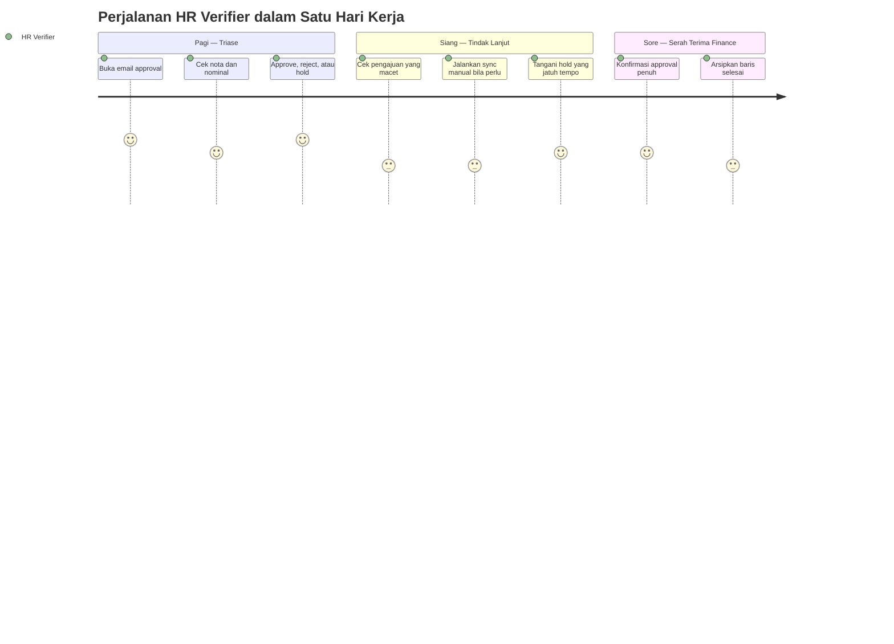

---

### 6.2 Authentication Flow

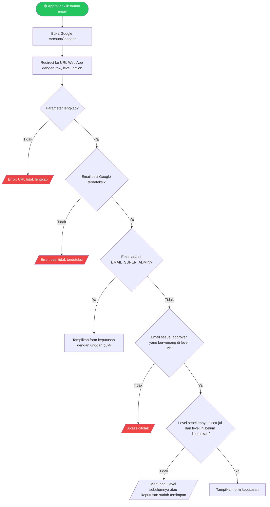

---

### 6.3 Main Application Flow

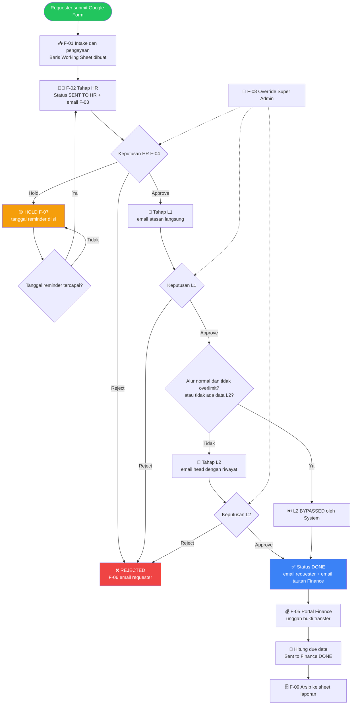

---

### 6.4 Critical Sub-Flow: Intake dan Routing

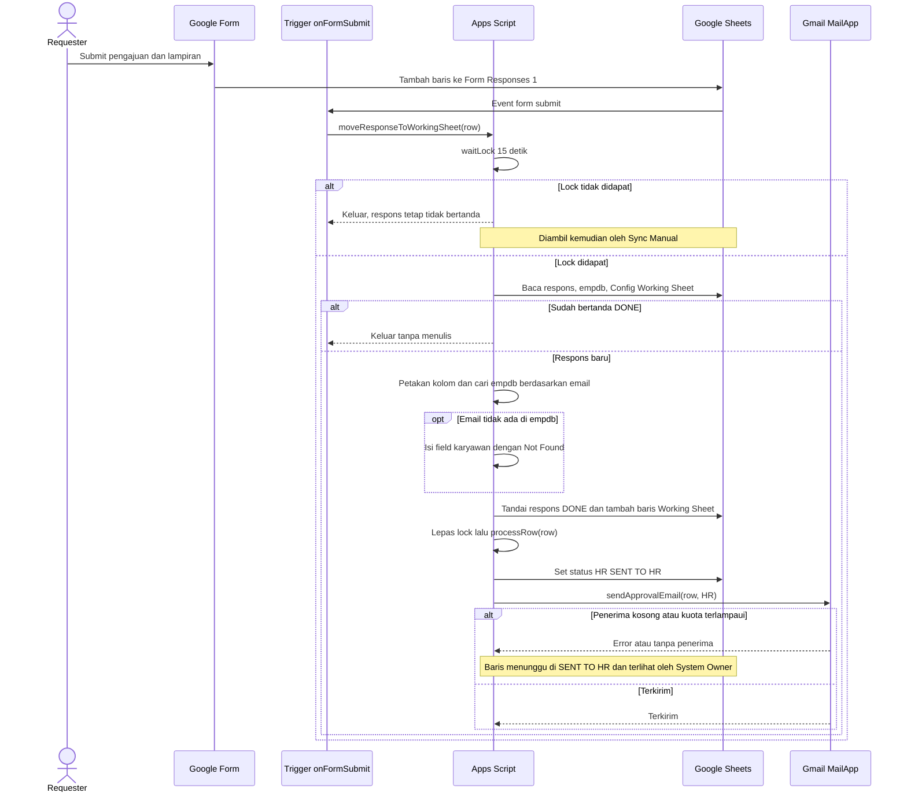

---

### 6.5 Critical Sub-Flow: Keputusan Approval

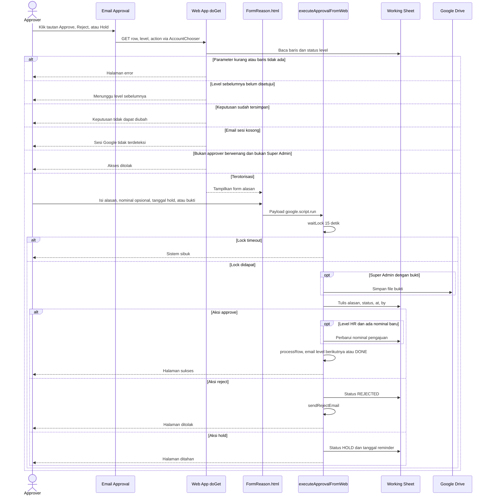

---

### 6.6 Critical Sub-Flow: Pencairan Finance

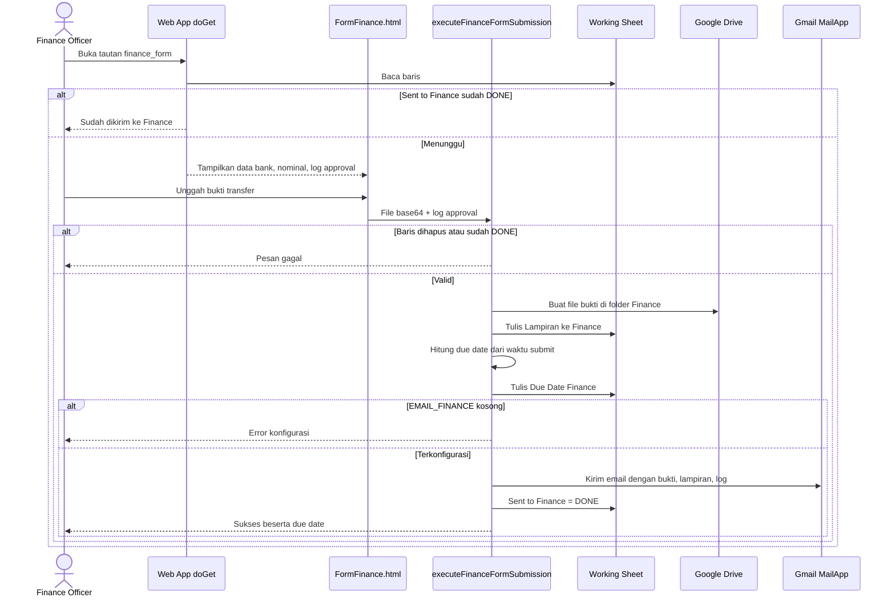

---

### 6.7 Critical Sub-Flow: Hold Reminder dan Arsip

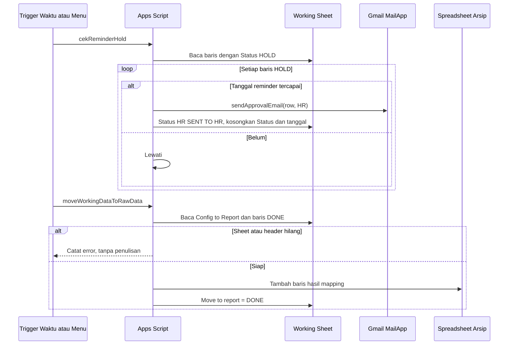

---

## 7. Screen & UI Breakdown

### Daftar Layar

| ID | Screen Name | Route / Path | Brief Description |
|----|-------------|--------------|-------------------|
| S-01 | Form Pengajuan Overlimit | Google Form (terhubung ke Sheet) | Input requester: nominal, alasan, detail, lampiran, tanggal transaksi |
| S-02 | Email Approval | Gmail (HTML) | Detail, lampiran, tombol Approve / Reject / Hold per level |
| S-03 | Form Keputusan | `{WEB_APP_URL}?row=&level=&action=approve\|reject\|hold` | Alasan (wajib), ubah nominal HR, tanggal hold, bukti Super Admin |
| S-04 | Form Pencairan Finance | `{WEB_APP_URL}?row=&level=FINANCE&action=finance_form` | Data bank, nominal, log approval, unggah bukti transfer |
| S-05 | Halaman Status / Error | Route Web App yang sama | Hasil keputusan atau aksi yang diblokir |
| S-06 | Working Sheet & Menu Admin | Google Sheet, menu `SISTEM APPROVAL` | Tampilan operasional dan aksi pemulihan |
| S-07 | Email Hasil | Gmail (HTML) | Approval final, penolakan, dan notifikasi Finance |

### Wireframe / Layout Notes

**S-03: Form Keputusan**
```
┌────────────────────────────────────────────────────┐
│  APPROVE / REJECT / HOLD     (warna sesuai aksi)   │
├────────────────────────────────────────────────────┤
│  Baris pengajuan #[N]   Level: [HR|L1|L2]          │
│                                                    │
│  ✏️ Edit Total Pengajuan   [ 911000        ]  (HR) │
│  📅 Reminder Hold          [ tanggal-jam    ] (Hold)│
│  📎 Bukti Super Admin      [ pilih file     ] (SA) │
│                                                    │
│  Justifikasi / alasan (wajib)                      │
│  ┌──────────────────────────────────────────────┐  │
│  │                                              │  │
│  └──────────────────────────────────────────────┘  │
│                         [ Kirim ]                  │
└────────────────────────────────────────────────────┘
```

---

## 8. Architecture

### System Architecture Overview

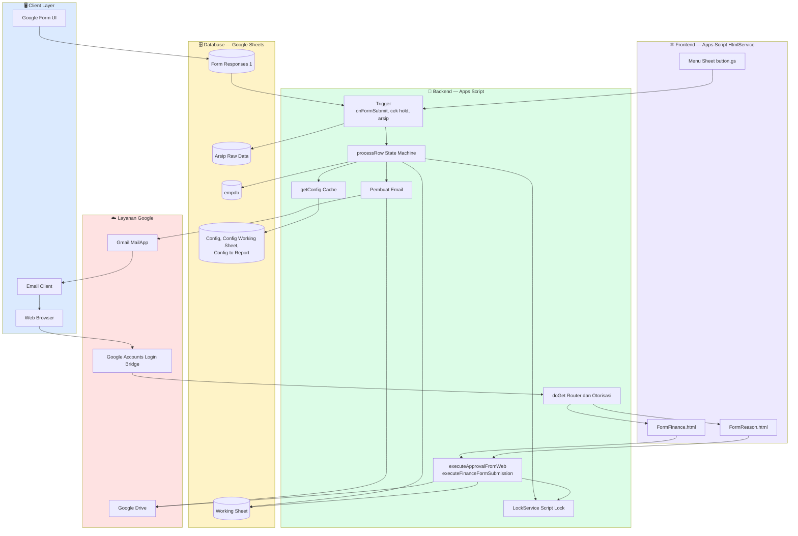

### Data Flow — Proses Utama

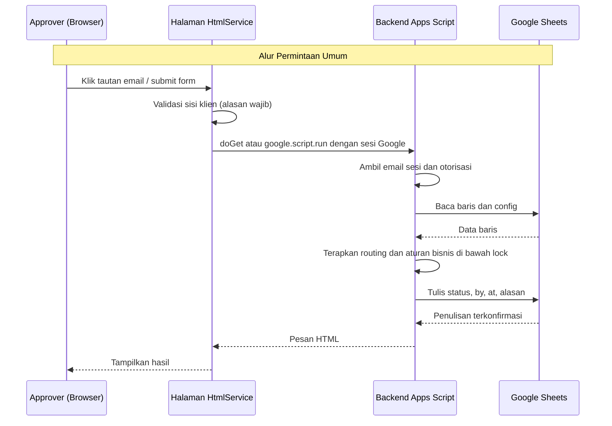

---

## 9. Database Schema

> "Database" adalah Google Sheets. Entitas di bawah adalah tabel logis; pemetaan fisiknya ada pada Deskripsi Tabel. Header sheet dicocokkan tanpa peka huruf besar/kecil setelah di-trim, dan nama kolom dapat dikonfigurasi lewat `Config`.

### Entity Relationship Diagram (ERD)

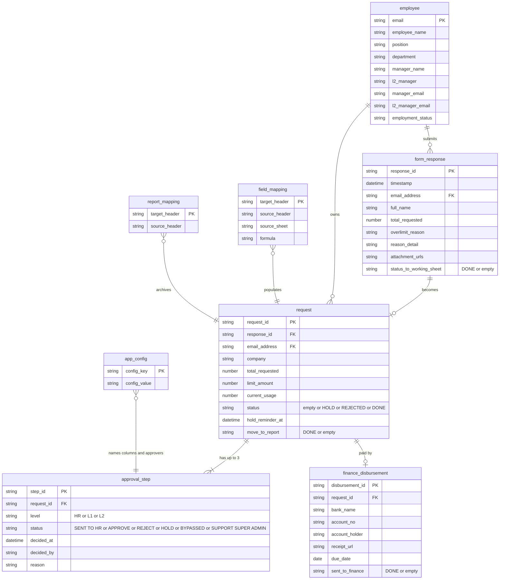

### Deskripsi Tabel

| Table | Description | Key Columns |
|-------|-------------|-------------|
| **employee** | Sheet `empdb`: data master untuk lookup berdasarkan email (rantai atasan, departemen, status kepegawaian). Field bank untuk Finance diharapkan ada di sini atau di formula (Q-03) | `Email Address` (unik) |
| **form_response** | Sheet `Form Responses 1`: output Form mentah, append-only; `status to working sheet` mencegah salin ganda | `Timestamp`, `status to working sheet` |
| **request** | Sheet `Working Sheet`: satu baris per pengajuan; juga memuat kolom approval dan finance yang diratakan. `request_id` diusulkan (F-11); saat ini pengenalnya adalah nomor baris | `Status`, `Move to report`, `Limit`, `Current Usage` |
| **approval_step** | Entitas logis yang tersimpan sebagai grup kolom di `Working Sheet`: `Approval {HR/L1/L2}`, `… at`, `… by`, `Reason By {…}` | status level, nilai bypass `Approval L2` |
| **finance_disbursement** | Entitas logis yang tersimpan sebagai kolom: `Sent to Finance`, `Lampiran ke Finance`, `Due Date Finance`, plus kolom bank | `Sent to Finance` |
| **app_config** | Sheet `Config`: key/value (kolom B, cadangan kolom C). Key: nama kolom `HEADER_*`, `EMAIL_HR`, `EMAIL_FINANCE`, `EMAIL_SUPER_ADMIN`, `CC_HR`, `CC_L1`, `CC_L2`, `CC_ALL_HR_ADMIN` | `config_key` |
| **field_mapping** | Sheet `Config Working Sheet`: cara setiap kolom Working Sheet diisi (Form, `empdb`, atau formula dengan `{row}`, `{email_col}`) | `Target Header` |
| **report_mapping** | Sheet `Config to Report`: mapping kolom arsip | `Target Header` |
| **archive** | Spreadsheet terpisah, sheet `Raw Data Overlimit Reimbursement` | header hasil mapping |

### Indexing Strategy
Google Sheets tidak memiliki index. Pencarian berupa pemindaian linear (`empdb` berdasarkan email, Working Sheet berdasarkan nama karyawan untuk riwayat, pemindaian hold berdasarkan `Status`). Strategi yang berlaku: (1) jaga Working Sheet tetap kecil dengan arsip, (2) baca range dalam satu panggilan, dan (3) gunakan SQL di bawah bila data suatu saat dimigrasi ke penyimpanan relasional.

```sql
-- Cermin relasional target (hanya bila dimigrasi); setiap index dipetakan ke query yang dipakai saat ini
CREATE UNIQUE INDEX idx_employee_email        ON employee(lower(email));             -- lookup empdb saat submit
CREATE INDEX idx_request_employee_month       ON request(email_address, created_at); -- tabel riwayat bulan berjalan untuk L2
CREATE INDEX idx_request_status               ON request(status);                    -- pemindaian hold reminder dan sync pending
CREATE INDEX idx_request_move_to_report       ON request(move_to_report, status);    -- seleksi arsip (DONE dan belum dipindah)
CREATE UNIQUE INDEX idx_approval_step_level   ON approval_step(request_id, level);   -- satu keputusan per level
CREATE UNIQUE INDEX idx_finance_request       ON finance_disbursement(request_id);   -- penjaga submit sekali
```

---

## 10. API Endpoints

> Sistem mengekspos satu Web App Apps Script (deployment: execute as owner, akses "Anyone with Google account") dan dua fungsi server yang dipanggil dari halaman HTML dengan `google.script.run`. Respons saat ini berupa fragmen HTML, bukan JSON; bentuk JSON di bawah menggambarkan payload permintaan dan hasil logisnya.

### Web App Routes (`doGet`)
| Method | Endpoint | Description | Auth |
|--------|----------|-------------|------|
| `GET` | `{WEB_APP_URL_RAW}?row={n}&level={HR\|L1\|L2}&action=approve` | Buka form keputusan untuk approve | ✅ Sesi Google + kecocokan approver |
| `GET` | `{WEB_APP_URL_RAW}?row={n}&level={HR\|L1\|L2}&action=reject` | Buka form keputusan untuk reject | ✅ |
| `GET` | `{WEB_APP_URL_RAW}?row={n}&level=HR&action=hold` | Buka form keputusan untuk hold (hanya tautan HR) | ✅ |
| `GET` | `{WEB_APP_URL_RAW}?row={n}&level=FINANCE&action=finance_form` | Buka form pencairan Finance | ✅ Sesi Google (lihat Q-04) |

### Server Functions (`google.script.run`)
| Method | Function | Description | Auth |
|--------|----------|-------------|------|
| `RPC` | `executeApprovalFromWeb(data)` | Simpan approve / reject / hold, picu routing | ✅ email sesi → cek Super Admin |
| `RPC` | `executeFinanceFormSubmission(data)` | Simpan bukti, hitung due date, email Finance | ✅ |

### Triggers & Menu Entrypoints
| Method | Function | Description | Auth |
|--------|----------|-------------|------|
| `TRIGGER` | `onFormSubmit(e)` | Intake dan routing untuk respons baru | Pemilik script |
| `TRIGGER / MENU` | `cekReminderHold()` | Buka kembali pengajuan HOLD yang tanggalnya tiba | Pemilik script / System Owner |
| `TRIGGER / MENU` | `moveWorkingDataToRawData()` | Arsipkan baris DONE | Pemilik script / System Owner |
| `MENU` | `runManualForAllPending()`, `resendRejectEmailViaPrompt()` | Pemulihan | System Owner |

### Kalender SLA Finance (dihitung di `executeFinanceFormSubmission`)
| Waktu submit (GMT+7) | Due date |
|---|---|
| Senin 16:00 → Kamis 15:59 | Selasa berikutnya |
| Kamis 16:00 → Senin 15:59 | Kamis berikutnya |

### Contoh Request & Response

**RPC `executeApprovalFromWeb`**
```json
// Request
{
  "row": 12,
  "level": "HR",
  "action": "approve",
  "reason": "Nota terverifikasi, nominal dikoreksi sesuai nota",
  "newNominal": "850.000",
  "holdDate": "",
  "fileBase64": "",
  "fileMimeType": "",
  "fileName": ""
}

// Response (saat ini): string HTML
"<h3 style='color:#28a745;'>✔️ Sukses! Aksi APPROVE berhasil dicatat.</h3>"

// Response (saat ini, kasus error): string HTML, dipetakan ke kode error usulan
// LOCK_TIMEOUT      -> "❌ Sistem sibuk, coba beberapa saat lagi."
// ROW_NOT_FOUND     -> "❌ Gagal: Data sudah dihapus dari sistem."
// INTERNAL_ERROR    -> "❌ Terjadi kesalahan sistem internal."
```

**RPC `executeFinanceFormSubmission`**
```json
// Request
{
  "row": 12,
  "base64": "<file bytes base64>",
  "mimeType": "application/pdf",
  "fileName": "transfer.pdf",
  "logApproval": "HR Approved: hr@company.com at 15 Oct 2026 09:10 (OK)\nL1 Approved: ...\nL2 Approved: ..."
}

// Response (sukses saat ini): string HTML
"<h3 style='color:#28a745;'>✔️ Pengajuan Berhasil Disubmit ke Finance! (Due Date: Tue, 20 Oct 2026)</h3>"

// Response (error saat ini): string HTML
// ALREADY_SENT      -> "❌ Gagal: Data sudah dikirim ke Finance."
// FINANCE_EMAIL_MISSING -> "❌ Konfigurasi email Finance tidak ditemukan."
```

**Kontrak target usulan (F-11)**
```json
// Success
{ "success": true, "data": { "request_id": "b6f1…", "level": "HR", "status": "APPROVE" }, "meta": { "next_level": "L1" } }

// Error
{ "success": false, "error": { "code": "NOT_AUTHORIZED", "message": "Akun yang login bukan approver untuk level ini" } }
```

---

## 11. Design & Technical Constraints

### Technology Stack
| Layer | Technology Choice | Reason |
|-------|-------------------|--------|
| **Frontend** | Apps Script HtmlService (HTML + inline CSS + `google.script.run`) | Tanpa hosting; satu origin dengan backend; sesi Google tersedia |
| **Backend** | Google Apps Script (JavaScript V8) | Serverless, tier gratis, akses native ke Sheets, Gmail, Drive |
| **Database** | Google Sheets | Admin non-teknis dapat mengubah config dan data; tanpa infrastruktur |
| **Intake** | Google Forms | Unggah file dan pengumpulan email bawaan |
| **Auth** | Sesi akun Google via Web App ("Anyone with Google account") | Tanpa login kustom; identitas dari Google |
| **Notifications** | `MailApp` dengan alias send-as opsional | Native, tanpa setup SMTP |
| **File storage** | Folder Google Drive (lampiran, bukti transfer, bukti Super Admin) | Model izin sama dengan Sheets |
| **Deployment** | Apps Script Web App + installable trigger | Tanpa biaya; `clasp` disarankan untuk kontrol versi (lihat Q-10) |

### Typography Rules
**Pending.** Belum ada konfigurasi font yang diberikan atau disetujui. UI dan email saat ini memakai inline `Arial, sans-serif`. Tabel font contoh dari template sengaja tidak dibawa. Keputusan dicatat di Q-11.

| Role | Font Stack |
|------|-----------|
| **Sans** | Pending (saat ini: `Arial, sans-serif`) |
| **Serif** | Pending |
| **Mono** | Pending |

### Coding Standards
- **Language:** JavaScript (Apps Script V8); migrasi ke TypeScript via `clasp` + `@types/google-apps-script` diusulkan
- **Konfigurasi di atas kode:** nama kolom dan penerima ada di `Config`; tidak ada ID yang di-hard-code (ID folder, URL Web App, dan alias perusahaan yang saat ini hard-coded harus dipindah ke `Config`/Script Properties)
- **Linting:** ESLint + Prettier
- **Testing:** Unit test untuk aturan routing (`_processRowInternal`) dan perhitungan tanggal SLA; skrip UAT manual untuk setiap level dan kasus bypass
- **Git branching:** `main` (rilis), `develop`, `feature/*`
- **Commit format:** Conventional Commits (`feat:`, `fix:`, `docs:`)
- **Bahasa string UI:** Indonesia (saat ini); i18n di luar scope MVP

### Security Constraints
- Autentikasi setiap keputusan dengan `Session.getActiveUser().getEmail()`; tolak bila kosong
- Otorisasi dengan kecocokan email persis (bukan substring) terhadap daftar approver yang berwenang; daftar Super Admin dari `Config`
- Jangan menerima perubahan state hanya dari tautan `GET`: setiap keputusan wajib melalui submit form alasan
- Ganti tautan nomor baris dengan Request ID yang tidak dapat ditebak (F-11); pertimbangkan token bertanda tangan sekali pakai per tautan
- Akses edit sheet dibatasi untuk System Owner; lindungi kolom formula dan status dengan range protection
- Folder Drive privat untuk pemilik script; bagikan file hanya lewat tautan di email
- Rahasia dan ID (ID folder, URL Web App) disimpan di Script Properties, bukan di source
- Escape teks dari pengguna (nama, alasan, detail) sebelum dimasukkan ke halaman dan email HTML untuk mencegah HTML injection
- Pertahankan audit log append-only; riwayat keputusan tidak boleh dihapus
- Kontrol diselaraskan dengan prinsip akses dan logging ISO/IEC 27001 Annex A (A.5.15, A.8.15) sebagai panduan, bukan klaim sertifikasi

---

## 12. Out of Scope

Fitur-fitur berikut **tidak termasuk** dalam versi ini (MVP):

| Fitur | Alasan Tidak Dimasukkan | Kemungkinan Versi |
|-------|-------------------------|-------------------|
| Aplikasi mobile native | Email dan halaman web responsif sudah mencukupi | v3.0 |
| Migrasi ke database relasional / aplikasi web mandiri | Bertentangan dengan positioning tanpa infrastruktur | v2.0 |
| SSO (SAML/OIDC) selain akun Google | Identitas Google diasumsikan sebagai standar | v2.5 |
| Eksekusi pembayaran / integrasi API bank | Finance mencairkan secara manual dan mengunggah bukti | v2.0 |
| Rantai approval paralel atau kondisional di luar HR → L1 → L2 | Aturan saat ini sudah mencakup kebijakan yang diketahui | v2.0 |
| UI multi-bahasa | UI Bahasa Indonesia dapat diterima untuk pengguna saat ini | v2.0 |
| Delegasi / routing saat cuti | Override Super Admin sudah memenuhi kebutuhan | v1.5 |
| Dashboard / UI analitik | Spreadsheet arsip dapat menjadi sumber alat BI mana pun | v1.5 |
| Notifikasi WhatsApp / Slack | Email adalah satu-satunya kanal | v2.0 |

---

## 13. Risks & Mitigations

| ID | Risiko | Dampak | Kemungkinan | Mitigasi |
|----|--------|--------|-------------|----------|
| R-01 | Tautan memakai nomor baris sheet; menghapus atau mengurutkan baris membuat tautan menunjuk ke pengajuan lain | 🔴 Tinggi | 🟡 Sedang | Terapkan Request ID (F-11); kunci/lindungi sheet dari sort dan delete |
| R-02 | Siapa pun dengan akses edit sheet dapat mengubah status dan melewati approval | 🔴 Tinggi | 🟡 Sedang | Batasi akses edit; protected range; Audit Log append-only; tinjau riwayat edit berkala |
| R-03 | Email manajer kosong atau salah membuat pengajuan menunggu tanpa batas dan tanpa peringatan | 🟠 Sedang | 🟡 Sedang | Validasi config; digest harian "pengajuan macet" ke System Owner; laporan jumlah `Not Found` |
| R-04 | `getActiveUser()` kosong untuk sebagian akun konsumer atau lintas domain, sehingga approver terblokir | 🟠 Sedang | 🟡 Sedang | Batasi ke satu domain Workspace; dokumentasikan jenis akun yang didukung; fallback Super Admin |
| R-05 | Kuota email atau batas ukuran lampiran menghentikan email approval | 🔴 Tinggi | 🟡 Sedang | Gunakan akun Workspace (kuota lebih tinggi); catat kegagalan kirim; antrean retry; tautkan lampiran, jangan sematkan |
| R-06 | Hold reminder membaca kolom berbeda dari yang ditulis sehingga pengajuan HOLD tidak pernah dibuka kembali | 🟠 Sedang | 🔴 Tinggi | Perbaiki referensi kolom dan tambah test; lihat Q-06 |
| R-07 | Submit bersamaan atau retry menyebabkan pemrosesan ganda | 🟠 Sedang | 🟢 Rendah | Script lock + penjaga `DONE` (sudah ada); submit finance idempoten |
| R-08 | ID folder Drive dan URL Web App yang masih placeholder menyebabkan unggahan gagal diam-diam | 🟠 Sedang | 🟡 Sedang | `validateConfig()` sebelum go-live; pindah ke Script Properties |
| R-09 | Teks pengguna tanpa escape dimasukkan ke halaman dan email HTML (HTML injection) | 🟠 Sedang | 🟡 Sedang | Escape output; batasi field hanya teks |
| R-10 | Pertumbuhan Working Sheet menurunkan performa (pemindaian linear; batas eksekusi 6 menit) | 🟠 Sedang | 🟡 Sedang | Arsip terjadwal; batas jumlah baris; pembacaan batch |
| R-11 | Data pribadi dan bank di Sheets/Drive menimbulkan kewajiban privasi dan retensi | 🔴 Tinggi | 🟡 Sedang | Kontrol akses, kebijakan retensi, samarkan nomor rekening di email bila memungkinkan; selaraskan dengan hukum perlindungan data pribadi yang berlaku (Q-09) |
| R-12 | Ketergantungan pada perubahan platform Google (kuota Apps Script, perilaku Web App, URL AccountChooser) | 🟠 Sedang | 🟢 Rendah | Pakai API terdokumentasi; jaga permukaan integrasi tetap kecil; pantau release notes Google |

---

## 14. Timeline & Milestones

> Baseline kode (F-01 sampai F-10) sudah ada di repositori. Rencana di bawah mencakup verifikasi baseline dan pengerjaan rilis hardening, dimulai Senin 2026-10-19 (asumsi, Q-12).

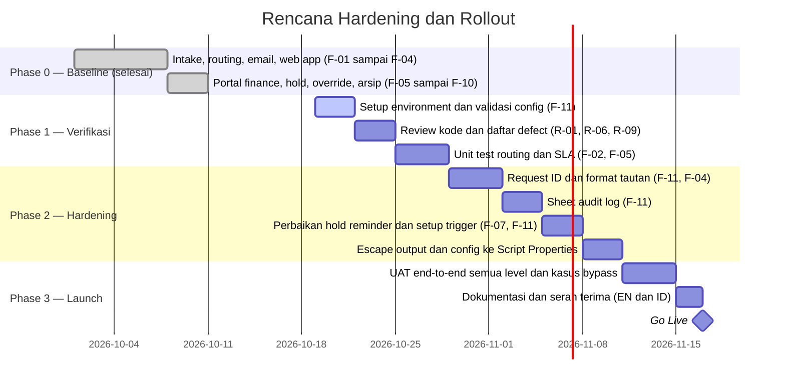

| Milestone | Target Tanggal | Deliverable |
|-----------|----------------|-------------|
| M-01: Kickoff | 2026-10-19 | PRD final, pemilik dan environment dikonfirmasi |
| M-02: Alpha | 2026-11-03 | Baseline terverifikasi, test suite routing dan SLA |
| M-03: Beta | 2026-11-17 | Hardening selesai (Request ID, audit log, trigger) |
| M-04: UAT | 2026-11-24 | Pengujian end-to-end dengan HR, manajer, Finance |
| M-05: Go Live | 2026-11-30 | Deployment production dan serah terima |

---

## 15. Open Questions

Pertanyaan dan asumsi yang perlu dikonfirmasi sebelum atau selama development. Baris Q-01 sampai Q-03 dan Q-08 sampai Q-12 adalah asumsi karena detailnya tidak diberikan pengguna.

| ID | Pertanyaan | Ditujukan ke | Deadline | Status |
|----|------------|--------------|----------|--------|
| Q-01 | **Asumsi:** PRD ini mendokumentasikan implementasi saat ini dan mengusulkan hardening, bukan produk baru. Apakah itu cakupan yang dimaksud? | Requester | 2026-10-21 | ⏳ Menunggu |
| Q-02 | **Asumsi:** target KPI di Bagian 2 (≤ 2 hari kerja, ≥ 95% sebelum due date) adalah usulan. Target dan baseline apa yang dipakai bisnis? | Stakeholder | 2026-10-28 | ⏳ Menunggu |
| Q-03 | **Asumsi:** kolom bank dan perusahaan yang dipakai form Finance (`Company`, `Nama Bank`, `No Rekening`, `Nama Pemilik Rekening`, `Region`, `Limit`, `Current Usage`) berasal dari formula `empdb` atau field Form yang tidak disertakan di `templates/`. Apa sumber dan formula sebenarnya? | System Owner | 2026-10-28 | ⏳ Menunggu |
| Q-04 | Tautan Finance dikirim ke `EMAIL_HR` dan route form finance tidak memeriksa identitas approver. Apakah perlu dibatasi ke akun Finance? | Stakeholder / Security | 2026-10-28 | ⏳ Menunggu |
| Q-05 | `Limit` atau `Current Usage` yang kosong di-parse sebagai 0, sehingga limit kosong membuat semua pengajuan overlimit. Apakah ini kebijakan yang dimaksud? | Product Owner | 2026-10-28 | ⏳ Menunggu |
| Q-06 | `cekReminderHold` membaca tanggal reminder dari kolom `HEADER_HR_AT` sementara hold menulis ke `Tgl Reminder Hold`. Apakah ini defect? (diasumsikan ya) | System Owner | 2026-10-26 | ⏳ Menunggu |
| Q-07 | Keputusan Super Admin tetap tercatat meski unggah bukti gagal atau ID folder masih placeholder. Apakah bukti harus wajib? | Stakeholder / Audit | 2026-10-28 | ⏳ Menunggu |
| Q-08 | **Asumsi:** hanya System Owner yang punya akses edit ke Working Sheet; HR/Finance bekerja lewat email dan form. Benar? | System Owner | 2026-10-26 | ⏳ Menunggu |
| Q-09 | **Asumsi:** tidak ada periode retensi atau regulasi data pribadi yang ditetapkan. Kebijakan mana yang berlaku (misal UU PDP, retensi perusahaan)? | Legal / HR | 2026-11-03 | ⏳ Menunggu |
| Q-10 | **Asumsi:** source dikelola dengan `clasp` dan Git; deployment oleh System Owner. Apakah tersedia spreadsheet staging? | System Owner | 2026-10-28 | ⏳ Menunggu |
| Q-11 | Tipografi belum ditentukan. Tetap Arial atau memakai font brand? | Design / Stakeholder | 2026-11-03 | ⏳ Menunggu |
| Q-12 | **Asumsi:** proyek mulai 2026-10-19 dan go-live 2026-11-30; tidak ada deadline atau anggaran pasti yang diberikan. | Requester | 2026-10-21 | ⏳ Menunggu |
| Q-13 | README menyuruh mengedit `Main.gs`, padahal file-nya `code.gs`, dan template `Working Sheet` serta `Config` tidak ada di `templates/`. Apakah repo perlu menyertakannya? | Maintainer | 2026-10-28 | ⏳ Menunggu |
| Q-14 | `BYPASSED` pada L1 diterima oleh router tetapi tidak pernah diset oleh kode. Apakah bypass L1 manual atau berbasis formula adalah use case yang didukung? | Product Owner | 2026-10-28 | ⏳ Menunggu |
| Q-15 | Logika perusahaan yang di-hard-code (alur normal `company a`, alamat alias) perlu digeneralisasi. Apa aturan yang dimaksud per perusahaan? | Stakeholder | 2026-10-28 | ⏳ Menunggu |

---

## Changelog

| Versi | Tanggal | Perubahan | Author |
|-------|---------|-----------|--------|
| 1.0.0 | 2026-10-17 | Dokumen awal dibuat dari analisis repositori | indarto.b@gmail.com |

---

*Dokumen ini adalah "living document" — akan terus diperbarui seiring perkembangan proyek. Semua perubahan signifikan harus dicatat di Changelog.*
